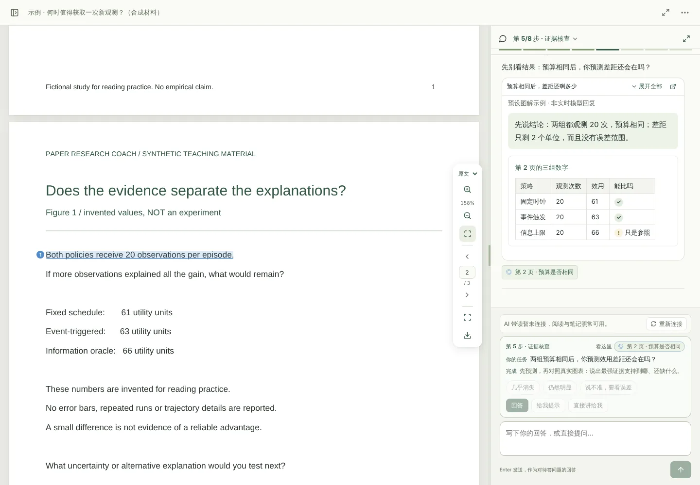
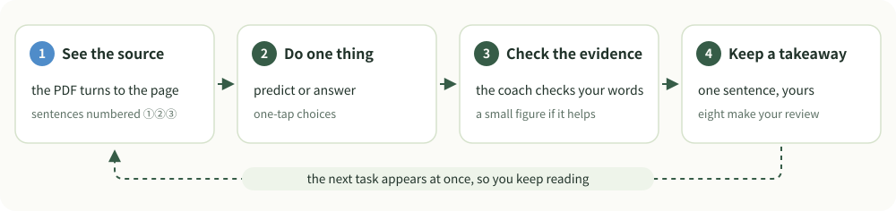
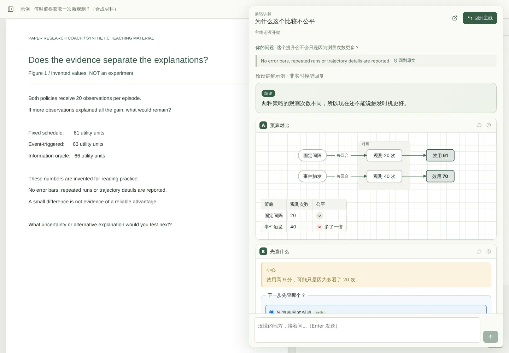
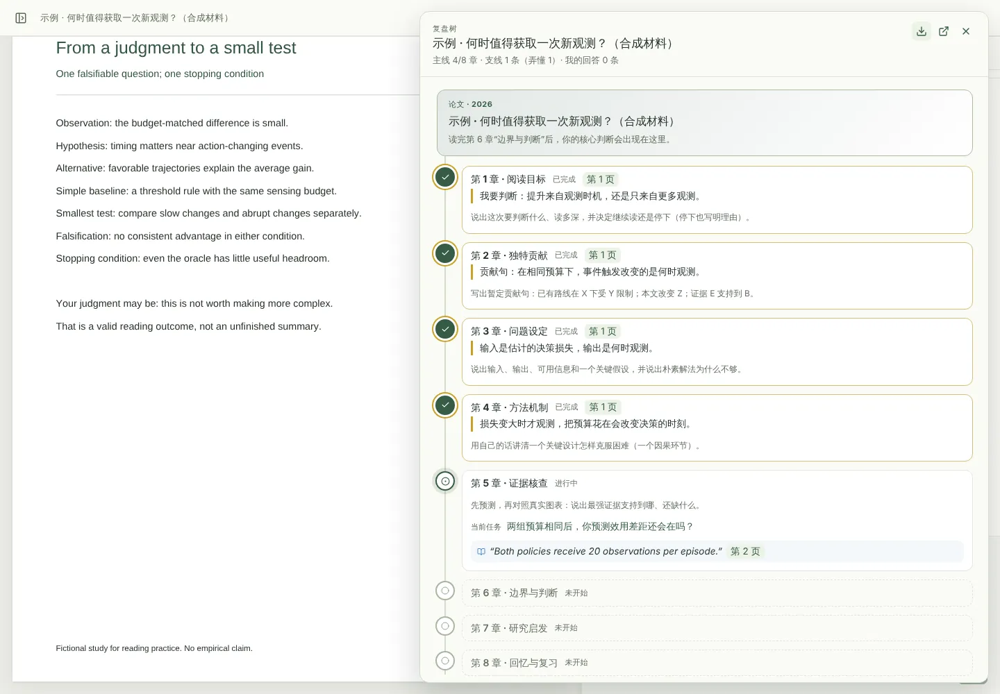

<div align="center">


# Paper Research Coach

### Read beyond the summary. Make the judgment your own.

A local PDF workbench, a reading-coach Skill for Claude Code, Codex and Pi, and a plugin build that runs inside DeepSeek Harness.<br>
The coach points at the sentence, hands you one small task, and leaves the judgment with you.

[](https://github.com/ooooooomygosh/paper-research-coach/actions/workflows/verify.yml)
[](https://github.com/ooooooomygosh/paper-research-coach/releases)
[](docs/QUICKSTART.md)
[](LICENSE)

[简体中文](README.md) · **English** · [Quick start](docs/QUICKSTART.md) · [Reading method](docs/METHOD.en.md) · [Workbench guide](docs/WORKBENCH.en.md) · [DSH plugin](docs/DEEPSEEK_HARNESS.md#english) · [Contributing](CONTRIBUTING.md)

</div>

<br>

<picture>
  <source media="(prefers-color-scheme: dark)" srcset="docs/images/mainline-dark.webp">
  
</picture>

<p align="center"><sub>Actual UI, following your light / dark theme · synthetic paper and a labelled scripted reply, not live-model output · <a href="docs/SHOWCASE.md">Reproduce</a></sub></p>

> [!NOTE]
> Preview software, not a proven learning intervention. The newest packages are the **top** entry on [Releases](https://github.com/ooooooomygosh/paper-research-coach/releases) (pre-releases, so GitHub's “Latest” badge does not point to them). Once installed, it updates itself.

## How a paper gets read

<picture>
  <source media="(prefers-color-scheme: dark)" srcset="docs/images/loop-en-dark.svg">
  
</picture>

Eight chapters carry you through a paper: goal, contribution, problem setup, mechanism, evidence, limits and judgment, what it suggests for your own work, and recall. Each chapter is the same loop: the page turns to the passage, you do one small task, the paper checks you, and you write one sentence of your own.

Questions that come up mid-chapter hang under that chapter as side quests. The explanation opens as a page of text and figures in the conversation, and any block can be followed up on its own. The mainline waits where it was until you say you understood. After chapter eight the whole run becomes a review tree you can export as offline HTML.

No XP, no mastery score. Finishing a chapter means this run covered that judgment, nothing more.

<table>
<tr>
<td width="50%"></td>
<td width="50%"></td>
</tr>
<tr>
<td align="center"><sub>A side quest opens in the conversation; every block can be pushed further</sub></td>
<td align="center"><sub>The review tree: source, your answers, your sentences, side quests</sub></td>
</tr>
</table>

## Three ways to use it

| | What it is | Start |
|---|---|---|
| **Workbench** (recommended) | A local PDF reader with the coaching conversation, plus annotations, notes, translation and Zotero sync | [One-line install](#workbench) |
| **Skill only** | Reading coaching inside Claude Code, Codex or Pi, on the host's own model configuration | [Two commands](#skill-only) |
| **DSH plugin** | The whole workbench inside DeepSeek Harness, using the signed-in Harness account: no API key, no Codex CLI | [Install](#deepseek-harness-plugin) |

All three share the same method and the same Skill. The workbench adds source location, annotations and offline records.

## Workbench

```bash
# macOS / Linux
curl -fsSL https://raw.githubusercontent.com/ooooooomygosh/paper-research-coach/main/scripts/install.sh | sh
```

```powershell
# Windows PowerShell (not yet run on real Windows; if it fails, use the manual steps in the quick start)
irm https://raw.githubusercontent.com/ooooooomygosh/paper-research-coach/main/scripts/install.ps1 | iex
```

The script finds the newest release, verifies its SHA-256, and installs into its own environment: [uv](https://docs.astral.sh/uv/) if present, else pipx, else `python -m venv`. No admin rights, no change to your library or shell configuration.

Then run `prc`, import a PDF, and press “开始跟读” (start reading). The AI conversation goes through your local Codex CLI, signed in once; without it, reading, marking, notes and export still work. To try first: `prc-demo` (a three-page synthetic paper that never touches your library).

While it runs, the workbench checks for updates at most once a day, verifies and installs in the background, and switches when nobody is reading; `prc update` does it by hand. Uninstalling leaves the library alone; `prc doctor` prints where it lives. Manual install, source runs and Windows details are in the [quick start](docs/QUICKSTART.md).

## Skill only

Claude Code:

```text
/plugin marketplace add ooooooomygosh/paper-research-coach
/plugin install paper-research-coach@paper-research-coach
```

Codex, Pi and other hosts:

```bash
npx skills add ooooooomygosh/paper-research-coach
```

Then attach a paper and say: "Walk me through this paper, starting with the finding the authors care about most." No Python, Node.js, Zotero or separate model key from this project.

Without npx: download `paper-research-coach-skill-*.zip` from [Releases](https://github.com/ooooooomygosh/paper-research-coach/releases) and unzip the **whole folder** into the host's skill directory (Codex `~/.agents/skills/`, Claude Code `~/.claude/skills/`, Pi `~/.pi/agent/skills/`). `SKILL.md` alone is not enough; it needs the `references` and `assets` beside it.

## DeepSeek Harness plugin

The whole workbench, built into [DeepSeek Harness](docs/DEEPSEEK_HARNESS.md) and calling models through the signed-in `deepseek-account`: no API key, no Codex CLI. It opens from the “论文研读” entry in the sidebar.

Plugin **1.1.0**, workbench **2.0.0rc13**, Harness **0.2.1-rc.5**.

| Platform | Install |
|---|---|
| Windows x64 | The `PRC-DSH-1.1.0-win-x64.zip` package (about 476 MiB) is built and handed out by the maintainer and is **not in Git**; the repo's wheel and Skill ZIP cannot stand in for it. Install and sign in to a compatible Harness, quit it, unzip the package, run `安装.cmd`, restart, then open “论文研读”. `卸载.cmd` uninstalls and keeps papers and learning records |
| macOS (Apple silicon) | No prebuilt package; build from source and register it into a Harness profile with `ports/deepseek-harness/macos/install-macos.sh`. Steps and limits: [macOS notes](ports/deepseek-harness/macos/README.md) |

On top of the existing reader, the plugin adds two things:

- **Knowledge-base learning** (integrating [Learn from Materials](https://github.com/dmoshehun-prog/learn-from-materials)): import PDF, DOCX, PPTX, EPUB and text material with source mapping, then build study pages, concepts, a method library, exercises and mistake records. Pausable, resumable, exportable.
- **Interactive explanations** (integrating [Answer me with HTML](https://github.com/QingYunA/answer-me-with-html)): turn a question, a paper page or a knowledge base into a page of flow charts, sequence diagrams, formulas and tables; edit the draft, switch themes, keep versions, export HTML.

The coach defaults to **DeepSeek Flash at high reasoning**. It never submits an effort level the model does not declare, and a failed turn now names the cause (quota, rate limit, context) instead of saying only “回复未完成”.

Data lives in `%USERPROFILE%\.dsh\paper-research-coach`, or `~/.dsh/paper-research-coach` on macOS (following `DSH_HOME` when set). Upgrading from the browser build: `macos/import-legacy.sh` moves the old library and translation cache across.

> [!NOTE]
> This is a third-party port, not an official DeepSeek release. The embedded build turns off the standalone workbench's auto-update, and a host upgrade needs a fresh compatibility check. Verbatim quote checks are not a semantic review; scanned pages and details inside figures still need your eyes, and exercise answers are model-generated references.

## How it differs from “summarise this paper”

| | A typical AI paper assistant | Paper Research Coach |
|---|---|---|
| What you get at once | A page of summary | One passage, one task, one definition of done |
| Who decides | The model states the conclusion | You make a provisional call, then check it against the paper; ask for a hint, an explanation, or a rebuttal |
| Where the evidence is | Hard to trace back | The PDF turns to the page and marks the sentence; every message and note jumps back |
| What is left afterwards | Another summary | One sentence of yours per step, open questions, the smallest next test |

## Data and limits

- PDFs and reading records stay on your machine, and the server listens on loopback only. Local storage is not offline AI: when the coach or translation runs, the relevant content goes to the model service you configured.
- At most once a day, one anonymous request goes to GitHub's releases API, carrying no papers, notes or identity. Auto-install accepts only packages published by this project that match the `SHA256SUMS` of the same release. Turn it off in Settings → 版本与更新, or with `PRC_NO_AUTO_UPDATE=1` / `PRC_NO_UPDATE_CHECK=1`.
- A sentence the coach asks you to read has to appear verbatim on that page, or it is not marked; pages without a text layer only turn, they do not get marks. A matching quote is not a correct argument, and checking the argument is still yours.
- Zotero writes need your explicit authorisation; the launch link carries a credential, so do not share it. See the [security guide](docs/SECURITY.md).
- No human trial of learning outcomes exists yet. OCR is not guaranteed for scanned PDFs. Zotero items with several attachments currently pick the first PDF, so check the version. See [testing](docs/TESTING.md) and the [review checklist](docs/FINAL-REVIEW.md).

## More documentation

| Document | What is in it |
|---|---|
| [Quick start](docs/QUICKSTART.md) | Manual install, running from source, Windows details, troubleshooting |
| [Reading method](docs/METHOD.en.md) | Seven principles, eight steps, and what each became in the workbench |
| [Workbench guide](docs/WORKBENCH.en.md) | Annotations, notes, translation, Zotero and folder sync, review and export |
| [DSH plugin](docs/DEEPSEEK_HARNESS.md#english) | The Harness port: entry points, data, build |
| [Design](docs/DESIGN.md) | Trade-offs in the interaction and the implementation |
| [Testing](docs/TESTING.md) | Automated coverage, screenshot reproduction, what is not verified |
| [Contributing](CONTRIBUTING.md) | Dev setup, tests, what a useful issue contains |

Roadmap and priorities are discussed in [Issues](https://github.com/ooooooomygosh/paper-research-coach/issues).

## Licence and credits

Original code and docs are [MIT](LICENSE). To cite the project, use “Cite this repository” in the sidebar ([CITATION.cff](CITATION.cff)). Sources for the reading method are in [sources and credits](docs/SOURCES.md); third-party attribution is in [explanation pages and writing rules](docs/THIRD_PARTY_ANSWER_ME_WITH_HTML.md) and [translation components](docs/THIRD_PARTY_TRANSLATION.md).
