<div align="center">


# Paper Research Coach

### Read beyond the summary. Make the judgment your own.

A local PDF workbench, plus a reading-coach Skill for Claude Code, Codex and Pi.<br>
The coach takes you to the sentence in the paper, gives you one small task at a time, and leaves the judgment in your hands.

[](https://github.com/ooooooomygosh/paper-research-coach/actions/workflows/verify.yml)
[](https://github.com/ooooooomygosh/paper-research-coach/releases)
[](docs/QUICKSTART.md)
[](#-quick-start)
[](#staying-current)
[](LICENSE)

[简体中文](README.md) · **English** · [Quick start](docs/QUICKSTART.md) · [Reading method](docs/METHOD.en.md) · [Workbench guide](docs/WORKBENCH.en.md) · [Design](docs/DESIGN.md) · [Contributing](CONTRIBUTING.md)

</div>

<br>

<picture>
  <source media="(prefers-color-scheme: dark)" srcset="docs/images/mainline-dark.webp">
  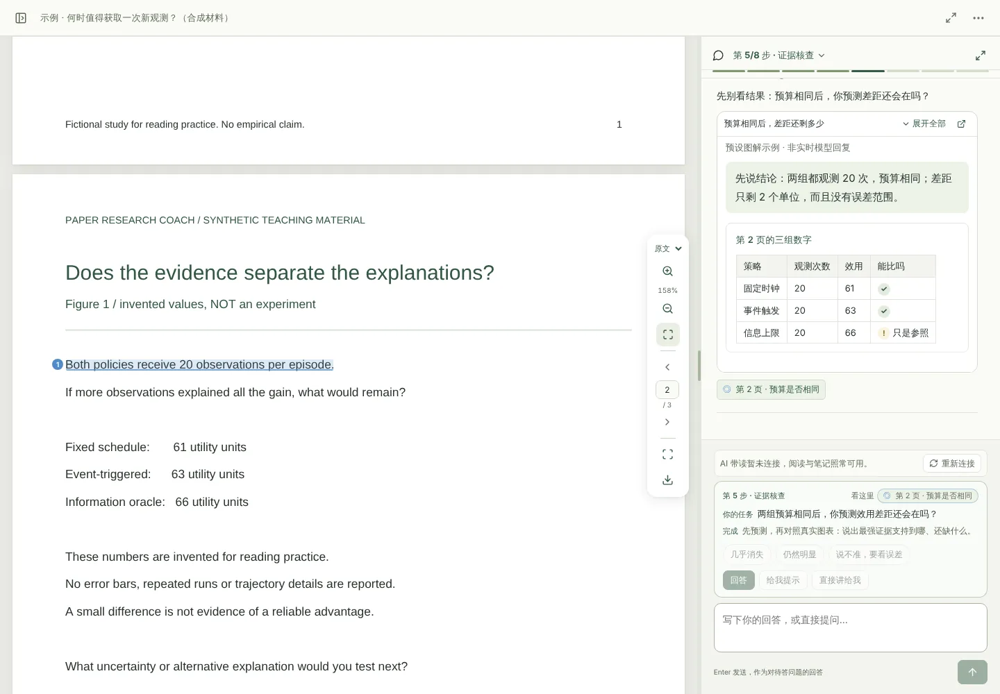
</picture>

<p align="center"><sub>Actual UI, following your light / dark theme · synthetic paper and a labelled scripted reply, not live-model output; no model was connected, so the buttons are grey · <a href="docs/SHOWCASE.md">Reproduce</a></sub></p>

> [!NOTE]
> **Preview software, not a proven learning intervention.** The newest packages are the **top** entry on [Releases](https://github.com/ooooooomygosh/paper-research-coach/releases) (pre-releases, so GitHub’s “Latest” badge does not point to them). Once installed, it updates itself.

## ✨ One small task at a time, all the way through a paper

<picture>
  <source media="(prefers-color-scheme: dark)" srcset="docs/images/loop-en-dark.svg">
  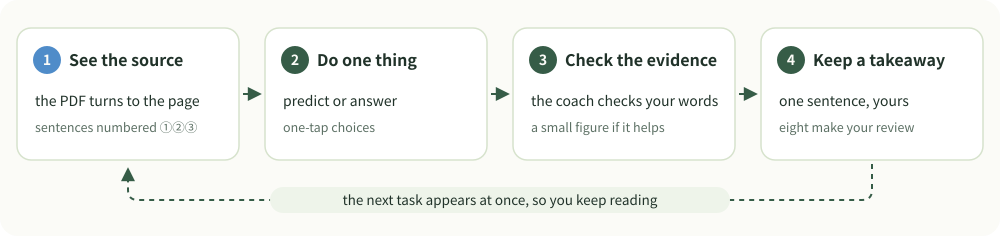
</picture>

The coach walks you through eight mainline chapters (reading goal → distinctive contribution → problem setting → mechanism → evidence → boundaries and judgment → research implications → recall), each one a small loop like the one above. A concrete question halfway through opens a one-page visual explanation right in the conversation: a side quest. When you get it, press “我弄懂了” (I get it now); the mainline is where you left it.

<p align="center">
  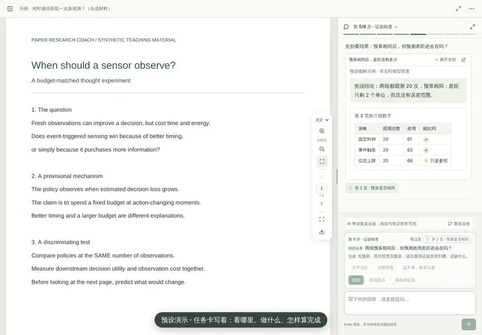
  <br><sub>Animated demo · synthetic paper and scripted replies, not live-model output (captions in Chinese)</sub>
</p>

## 🎮 Read a paper like a quest

The mainline has eight chapters, one quest card each. The questions you ask on the way are side quests, filed under the chapter you were in. When you finish, the whole reading becomes a journey tree. There are no points and no mastery scores: finishing a chapter only means this round covered that judgment.

<table>
<tr>
<td width="50%">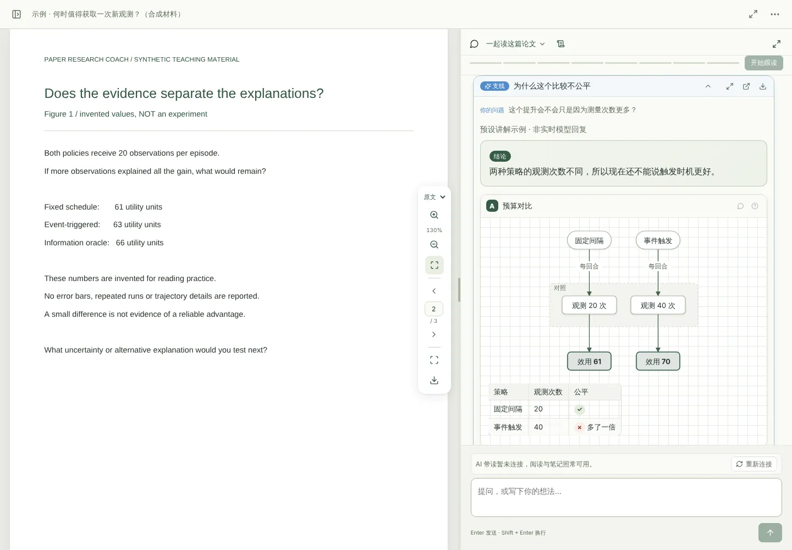</td>
<td width="50%">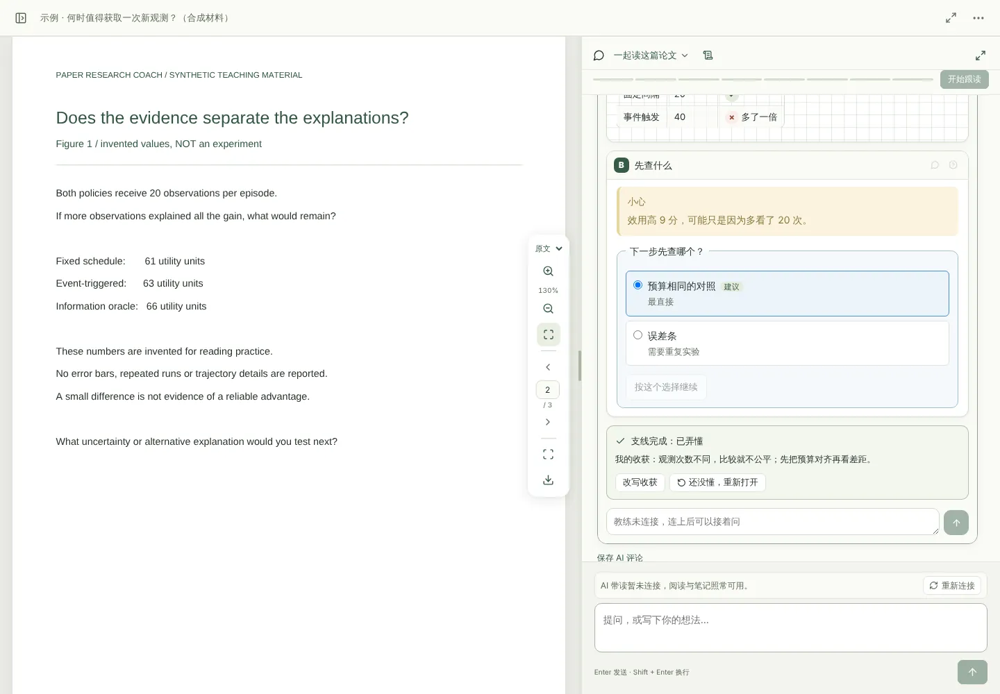</td>
</tr>
<tr>
<td align="center"><sub><b>A side quest</b> · one explainer page, opened in the conversation</sub></td>
<td align="center"><sub><b>Side quest done</b> · one sentence in your words, kept as written</sub></td>
</tr>
<tr>
<td>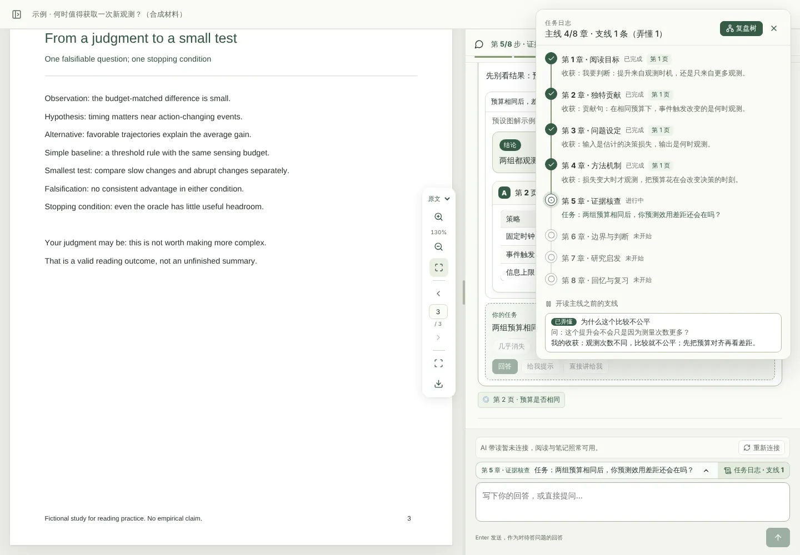</td>
<td>
<picture>
  <source media="(prefers-color-scheme: dark)" srcset="docs/images/journey-dark.webp">
  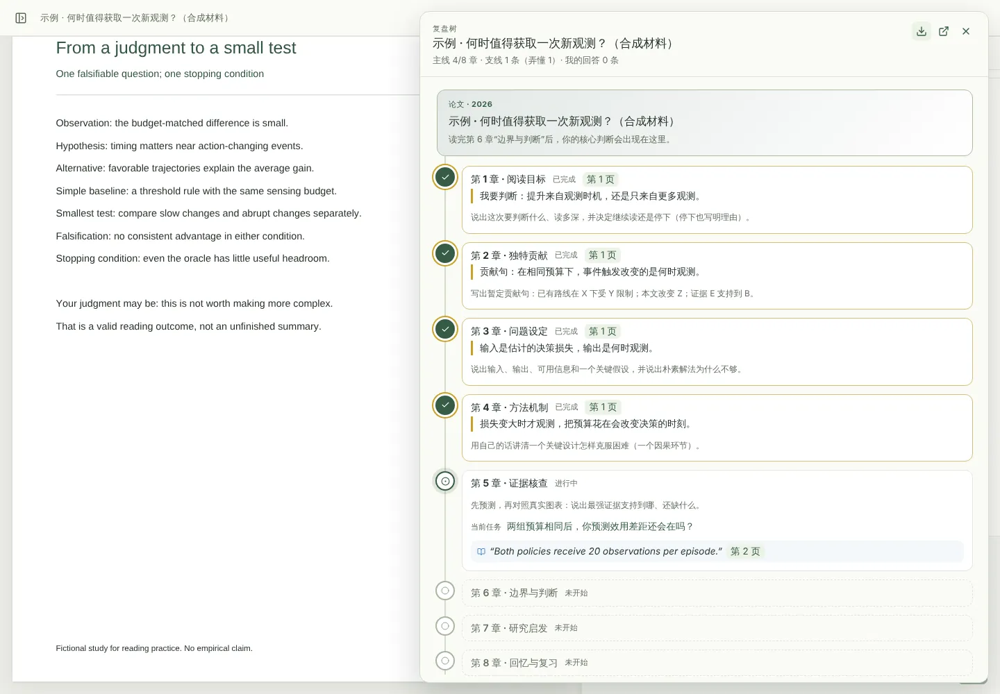
</picture>
</td>
</tr>
<tr>
<td align="center"><sub><b>Quest log</b> · eight chapters and the side quests under each</sub></td>
<td align="center"><sub><b>Journey tree</b> · passages, your answers, takeaways and side quests in one tree; downloadable as HTML</sub></td>
</tr>
</table>

| | What it is | When it is done |
|---|---|---|
| **Main quest** | Eight chapters, one card each: look here (the sentence marked in the PDF), your task (often one tap), the takeaway when it is done | The coach checks your answer against the source; you keep one sentence |
| **Side quest** | A concrete question you asked while reading. The page opens in the conversation; follow-ups become its next pages | Only you can press “I get it now” (with one sentence of your own) or “set it aside” |
| **Quest log** | The eight chapters with their takeaways, and the side quests under each | Open it any time; one click goes back to the page or the PDF |
| **Journey tree** | The paper and your core judgment at the root; under each chapter the marked passages, your verbatim answers, the coach's first sentence, takeaways, side quests and notes | Offered when chapter 8 is done; also written into the Markdown paper card |

<p align="center"><sub>Screenshots use a synthetic paper and clearly labelled scripted content, not live model output.</sub></p>

## 🎨 Ask, and it is drawn: what Answer me with HTML changed

The explainer pages build on [Answer me with HTML](https://github.com/QingYunA/answer-me-with-html) (QingYunA, MIT). The coach writes neither long paragraphs nor HTML: it writes a short Markdown draft, and the workbench draws the page.

| Before | Now |
|---|---|
| A “why” got several paragraphs | One conclusion first, then panels A, B, C: a flow chart, a comparison table, a formula, a callout |
| Answers got lost in the chat | Each question is a side quest under its chapter, easy to find in the quest log and the journey tree |
| Not following meant asking again from scratch | Press “没看懂” on the one panel; the next page explains only that panel |
| Explanations sat apart from the paper | Pages cite PDF pages, and the coach marks the sentences ①② in the PDF |
| Mainline replies were plain text | A mainline reply is a quest card that can carry one small figure |
| Keeping a copy meant copy and paste | Explainer pages and the journey tree download as one offline HTML file |

- **Components**: `flow`, `sequence`, `tree`, `timeline`, `callout`, `ask`, `kv`, plus tables (✓ ✗ ! badges) and formulas. Two columns on wide screens; `{span=2}` makes a wide figure span both.
- **Why it feels natural**: pages are drawn from data only, so text in a draft never runs as HTML; each page starts with its conclusion; a writing check flags long sentences, passive voice and empty phrases, and the coach rewrites them before you see the page.
- **What we took**: the draft syntax and the writing-check rules are adapted from Answer me with HTML; the parser (Python) and the renderer (React) are our own, and its CLI is not bundled. See [THIRD_PARTY_ANSWER_ME_WITH_HTML.md](docs/THIRD_PARTY_ANSWER_ME_WITH_HTML.md).

## 🧭 Highlights

<table>
<tr>
<td width="33%" valign="top">

**🎯 Shows you the source**<br>
Wherever the coach is, the PDF turns there and numbers the sentences to read ①②③. Each must be on the page word for word, so it cannot be made up; one click takes you back.

</td>
<td width="33%" valign="top">

**✅ One small task at a time**<br>
The task card says where to look, what to do and what counts as done. Predictions are one tap; when a step is done the next task appears at once.

</td>
<td width="33%" valign="top">

**🎨 Ask, and it is drawn**<br>
A concrete question becomes a page in the conversation: flow charts, tables and formulas in lettered panels A, B, C. Ask about the one panel you did not follow. Fold it, enlarge it, pop it out or download it as HTML.

</td>
</tr>
<tr>
<td valign="top">

**📜 A smooth PDF**<br>
Scroll through all pages; pinch or Ctrl+scroll to zoom; click [12] or Figure 3 to jump there, and back.

</td>
<td valign="top">

**🖍️ Your words stay yours**<br>
A highlight is the paper's words, a note is yours, kept apart; each step keeps one takeaway, and together they are your review.

</td>
<td valign="top">

**🌐 Non-native friendly**<br>
Separates language barriers from conceptual gaps; no whole-paper translation needed; short sentences that keep qualifiers such as *may* and *under*.

</td>
</tr>
<tr>
<td valign="top">

**🔒 Local first**<br>
PDFs and notes stay on your computer; only the turns you send reach the model you configured.

</td>
<td valign="top">

**🔄 Stays current by itself**<br>
New versions are verified and installed in the background and take over when nobody is reading. Skill copies follow.

</td>
<td valign="top">

**🔌 Two ways, one method**<br>
Install the Skill for coaching in your agent, or use the workbench to read and discuss side by side. Zotero, translation and exports are optional.

</td>
</tr>
</table>

## 🖼️ A look around

<table>
<tr>
<td width="50%">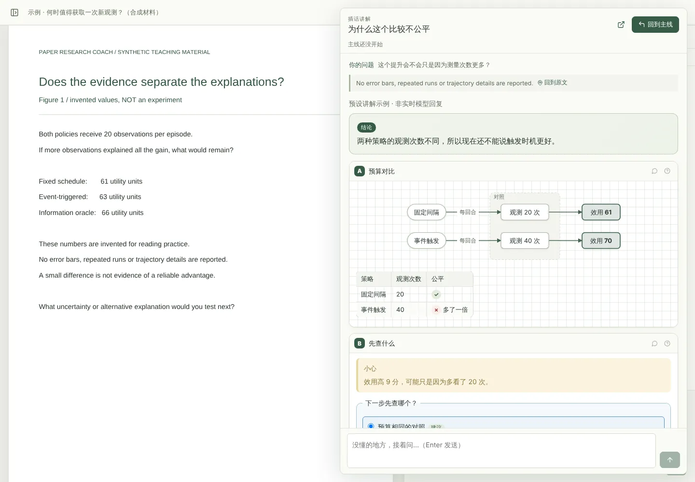</td>
<td width="50%">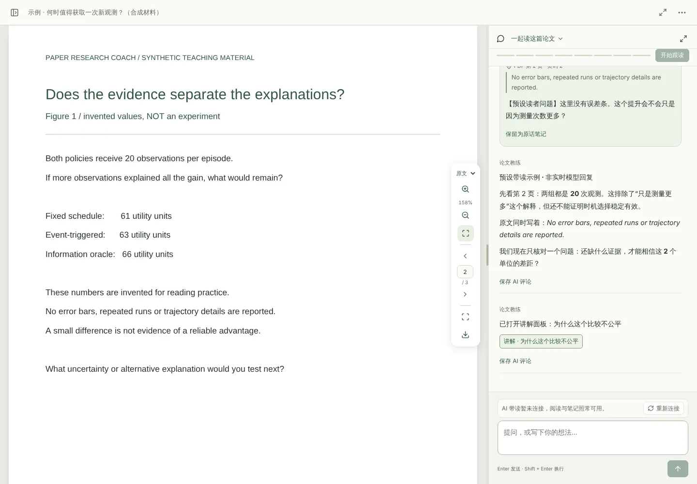</td>
</tr>
<tr>
<td align="center"><sub><b>Explainer page, enlarged</b> · “回到主线” leaves the mainline where it was</sub></td>
<td align="center"><sub><b>Talk about the source</b> · the quote travels with your question</sub></td>
</tr>
<tr>
<td>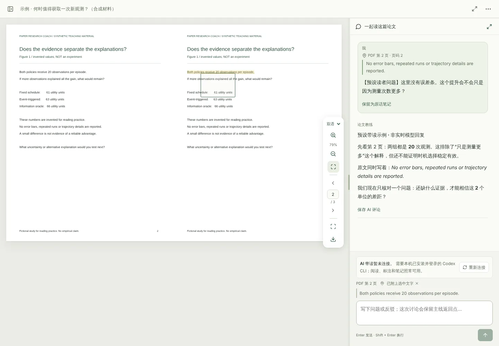</td>
<td>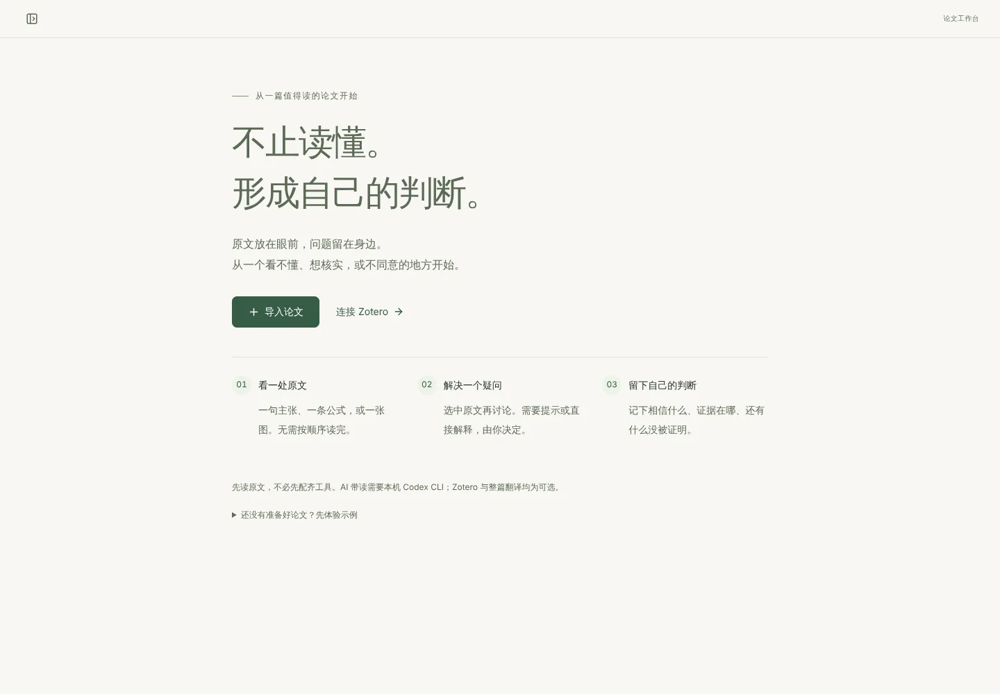</td>
</tr>
<tr>
<td align="center"><sub><b>Bilingual marks</b> · kept per rendition (both columns are synthetic English, a layout test)</sub></td>
<td align="center"><sub><b>First run</b> · import one PDF and start</sub></td>
</tr>
</table>

<p align="center"><sub>All screenshots use a synthetic paper and labelled scripted dialogue, not live-model output.</sub></p>

## 🚀 Quick start

| You want | Use |
|---|---|
| **To read and discuss side by side** (recommended) | [Option 1: the workbench](#option-1-the-workbench-one-line-install-three-steps) |
| AI coaching only, inside Claude Code or Codex | [Option 2: the Skill only](#option-2-the-skill-only) |

### Option 1: the workbench, one-line install, three steps

**1. Install.** Paste one line into a terminal.

```bash
# macOS / Linux
curl -fsSL https://raw.githubusercontent.com/ooooooomygosh/paper-research-coach/main/scripts/install.sh | sh
```

```powershell
# Windows PowerShell (not yet run on real Windows; if it fails, use the manual steps in the quick start)
irm https://raw.githubusercontent.com/ooooooomygosh/paper-research-coach/main/scripts/install.ps1 | iex
```

The script finds the newest release, **verifies its SHA-256**, and installs it into its own environment: with [uv](https://docs.astral.sh/uv/) if you have it (uv can fetch Python too), else pipx, else `python -m venv`. No admin rights, no change to your library or shell configuration. Read it first if you like: [install.sh](scripts/install.sh).

**2. Open.** Type `prc`. The browser opens the workbench; with no papers yet you see the welcome page. For a double-click launcher later, run `prc shortcut` and an icon appears on your Desktop.

**3. Read.** Import a PDF → press “开始跟读” (start reading) or select a passage and press “讨论这处” (discuss this). The AI coach uses your local Codex CLI, signed in once; without it, reading, marking and notes still work. To try first: `prc-demo` (a three-page synthetic paper that does not touch your library).

### Staying current

| What you use | How it updates |
|---|---|
| **The workbench** | **Nothing to do.** While it runs, it checks at most once a day, verifies a new version and installs it in the background. It switches over when nobody is reading; if a page is open, it says the new version is ready and **重新载入** (reload) takes about 5 seconds and keeps your place. The next `prc` also switches to it. By hand: `prc update`. |
| **The Skill inside the workbench** | It ships in the same package, so it updates with the workbench. |
| **A Skill installed separately** | Copied by `prc install-skill`: the workbench brings it to its own version each time it starts (by hand: `prc install-skill --sync`). Claude Code plugin: turn on auto-update for the marketplace, or run `/plugin marketplace update paper-research-coach`. Installed with `npx skills add`: run the same command again. |

At most once a day the workbench makes **one anonymous request** to GitHub's releases API. It sends no papers, notes or identity, and installs only a package published by this project that matches the `SHA256SUMS` of the same release. To stop automatic installs, switch it off in Settings → 版本与更新 or set `PRC_NO_AUTO_UPDATE=1`; to stop checking too, `PRC_NO_UPDATE_CHECK=1`.

### Option 2: the Skill only

**Claude Code (recommended)**

```text
/plugin marketplace add ooooooomygosh/paper-research-coach
/plugin install paper-research-coach@paper-research-coach
```

Attach a paper and ask: **“Guide my reading of this paper. Start with the authors' key observation.”** It uses your host's existing model; no Python, Node.js, Zotero or separate API key from this project is needed.

**Codex, Pi and other hosts**

```bash
npx skills add ooooooomygosh/paper-research-coach
```

<details>
<summary>Without npx: install the Skill by hand</summary>

Download `paper-research-coach-skill-*.zip` from the top entry on [Releases](https://github.com/ooooooomygosh/paper-research-coach/releases) and extract the **complete folder** into your host's skill directory:

| Host | User-level directory |
|---|---|
| Codex | `~/.agents/skills/paper-research-coach/` |
| Claude Code | `~/.claude/skills/paper-research-coach/` |
| Pi | `~/.pi/agent/skills/paper-research-coach/` |

Keep `references` and `assets`, not just `SKILL.md`. Format compatibility is not a claim that every host and model has been tested.

</details>

With the workbench installed, the Skill in Claude Code can attach to the same paper's reading progress through `prc`: `prc find` finds the page, `prc show` turns the PDF there and marks the sentences, and `prc explain` opens an explainer page (a side quest) in the conversation.

<details>
<summary>Uninstall, manual install, troubleshooting</summary>

- **Uninstall**: `uv tool uninstall paper-research-coach` (pipx: `pipx uninstall paper-research-coach`; venv: delete `~/.paper-research-coach` and `~/.local/bin/prc`). Your library is not deleted; `prc doctor` shows where it is.
- **Manual install, source installs, Windows details**: see the [Quick start](docs/QUICKSTART.md).
- **`prc` not found**: open a new terminal; if that fails, run the full path printed at the end of the install script.
- **Browser did not open**: `prc` prints the address; or run `prc` again.
- **AI not connected**: sign in to your local Codex CLI, then press “重新连接” (reconnect) in the conversation.

</details>

## 💬 What a turn looks like

> **Reader:** Could this gain just come from taking more measurements?
>
> **Coach:** (the PDF has turned to page 2 and marked ①) Look at ①: both groups observe 20 times, so the budgets match. Do you predict the gap survives? (one tap: almost gone / still clear / can't tell) A direct explanation is fine too.

<sub>An illustrative exchange, not a live-model result. Solving one local question or deciding not to pursue a paper are valid outcomes too.</sub>

| Your question | The coach's job |
|---|---|
| What did the authors actually notice? | Separate the distinctive observation from background and the proposed method. |
| Does this result support the claim? | Turn to the evidence page; check matched budgets, alternative explanations and limits. |
| Is my difficulty language or the concept? | Separate translation, prerequisite knowledge and the paper's argument; preserve qualifiers. |
| Where did my thought come from? | Keep your words apart from AI commentary, with a return path to the source. |
| What changes in my research next? | Record a provisional judgment, an open question or the smallest useful test. |

## 🆚 How it differs from “summarise this paper”

|  | Typical AI paper assistant | Paper Research Coach |
|---|---|---|
| **Each turn gives you** | A page-long summary | One passage, one task, what counts as done |
| **Who judges** | The AI states a conclusion | A provisional judgment, checked against the source; ask for a hint, a direct explanation, or a challenge |
| **Evidence** | Hard to trace back | The PDF turns to the page and marks the sentence; every message and note returns to its place |
| **Your thoughts** | Lost in the chat | Saved verbatim, apart from AI comments, with a page anchor |
| **What remains** | Another summary | One takeaway per step in your words, open questions and the smallest useful test |
| **Your data** | Uploaded | PDFs and notes stay local; only the turns you send reach the configured model |

## 📚 Why read this way

The habits students use most — rereading, highlighting, summarising — are among the least effective; familiarity with material in front of you easily passes for understanding, and a fluent AI summary makes the illusion stronger. This method spends its effort on getting **you** to predict, check, explain and recall. The pocket version: after each paper, be able to say **what judgment it changes, why you believe it, and how it changes your next step**.

<details>
<summary>Where the method comes from</summary>

| Source | Representatives | Practices it brings |
|---|---|---|
| Researchers’ experience | Harry Shum & Gang Hua’s “three levels, four stages, ten questions”, Shuyi Wang (relaying Peter Carr), Keshav, Mu Li, Nielsen, Hamming | Don’t read linearly: abstract → conclusion → figures → introduction → discussion, methods last, stop any time; skim / careful / study; ten questions as a coverage check; end with a next research step |
| Scientific method | Platt’s *Strong Inference*, Chamberlin’s multiple hypotheses, Popper, Toulmin | For a key claim, list alternatives and seek discriminating evidence and strong simple baselines |
| Learning science | Cognitive apprenticeship, scaffolding, cognitive load, retrieval practice, the generation effect, self-explanation | One move per turn; predict before looking; fade help by ability; keep your own words; recall with the paper closed |

Each paper should push you up one level: from **passive** reading (what it says) to **active** (what it is for), **critical** (does it hold up) and **creative** (what can I do with it).

</details>

👉 The seven principles, where the eight-step route comes from, and what each practice became in the workbench are in **[The reading method](docs/METHOD.en.md)**. These sources motivate the design; they do not show that this tool improves learning.

## 🗺️ Roadmap

What we are considering next. Tell us in [Issues](https://github.com/ooooooomygosh/paper-research-coach/issues) which one matters most to your reading:

- [ ] Models other than Codex in the workbench (for example Claude)
- [ ] Archive or delete papers and notes from the interface
- [ ] Import a paper from an arXiv or DOI link
- [ ] Search notes across papers; library-wide review reminders
- [ ] Export to Anki / BibTeX
- [ ] Text recognition (OCR) for scanned PDFs
- [ ] A study with real readers, to check whether it actually helps

## 🛡️ Privacy and limits

- Papers and reading records are stored locally and the service binds to loopback. **Local storage does not mean offline AI**: using the coach or translation sends relevant content to the configured model provider.
- The update check makes at most one anonymous request a day to GitHub's releases API, carrying no papers, notes or identity. By default a verified package from this project is installed in the background; switch that off in Settings, with `PRC_NO_AUTO_UPDATE=1`, or stop checking with `PRC_NO_UPDATE_CHECK=1`.
- Zotero writes require your authorization. Never share the launch link, which carries an access credential. See [Data and access boundaries](docs/SECURITY.md).
- There is no human learning-effect claim, no full Safari / iPad / Pencil certification and no guaranteed OCR for scanned PDFs. Zotero items with several attachments currently use the first PDF. See [Testing](docs/TESTING.md) and [Review](docs/FINAL-REVIEW.md).

## ❓ FAQ

<details>
<summary><b>Do I need a separate paid API key?</b></summary>

The Skill uses the model your host (Claude Code, Codex, Pi) is already configured with. The workbench's coach currently runs through a locally signed-in Codex CLI; reading, marking, notes and exports need no model at all.

</details>

<details>
<summary><b>Can the coach make up a quote?</b></summary>

When the coach asks you to look at a sentence, the workbench searches that page's text for it word for word; if it is not there, the mark is refused and the coach has to copy from the source again. Scanned pages have no text layer, so the PDF only turns to the page. Explanations and judgments can still be wrong, which is why every one of them keeps a way back to the source.

</details>

<details>
<summary><b>Does it update itself? How do I turn that off?</b></summary>

Yes. While it runs it checks at most once a day, installs a verified version in the background and switches over only when nobody is reading. Switch it off in Settings → 版本与更新, or set `PRC_NO_AUTO_UPDATE=1`.

</details>

<details>
<summary><b>Does it grade me or decide that I have “mastered” something?</b></summary>

No. Only if you enable recording of answers and feedback does it store one observation per ability, quoting your own words and the criterion used. Clicks, reading an AI explanation or completed steps are never treated as evidence of mastery.

</details>

<details>
<summary><b>Does it work with Zotero or Obsidian?</b></summary>

Yes, optionally. Zotero sync needs Zotero 10+ with the local API enabled and your authorization. OneDrive / Obsidian folders, bilingual translation, review and talk exports are covered in the [Workbench guide](docs/WORKBENCH.en.md).

</details>

<details>
<summary><b>What about scanned PDFs?</b></summary>

Automatic OCR is not guaranteed. You can mark a region and discuss its image with the coach; an empty text layer is not an empty page.

</details>

## 🤝 Contribute

Start with [CONTRIBUTING.md](CONTRIBUTING.md) and the [Code of Conduct](CODE_OF_CONDUCT.md). Describe the reading task that was interrupted, not just the control you would like to add. Use synthetic reproduction material; do not submit private PDFs, databases, credentials or conversations.

If this project helps you read, a star ⭐ helps other careful readers find it.

<a href="https://star-history.com/#ooooooomygosh/paper-research-coach&Date">
  <picture>
    <source media="(prefers-color-scheme: dark)" srcset="https://api.star-history.com/svg?repos=ooooooomygosh/paper-research-coach&type=Date&theme=dark">
    
  </picture>
</a>

## 📄 License and credits

Original code and documentation: [MIT](LICENSE). To cite this project, use “Cite this repository” in the sidebar ([CITATION.cff](CITATION.cff)). [Reading-method sources](docs/SOURCES.md), [explainer and writing-rule attribution](docs/THIRD_PARTY_ANSWER_ME_WITH_HTML.md) and [translation-component licensing](docs/THIRD_PARTY_TRANSLATION.md) retain their respective boundaries.
