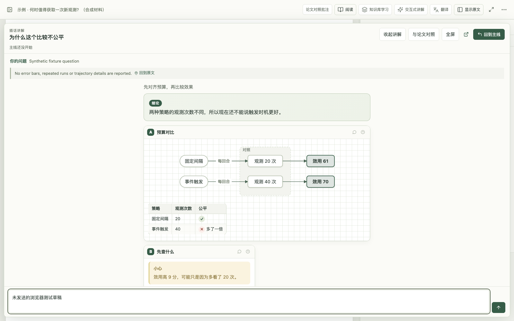
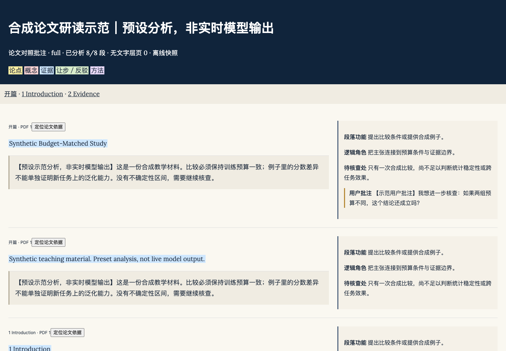
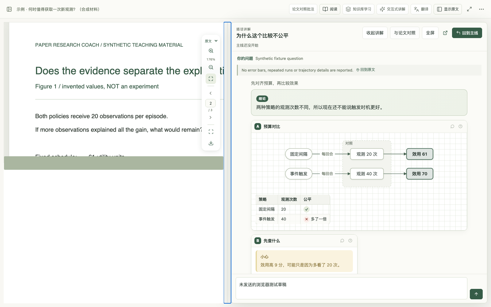

<div align="center">


# Paper Research Coach

### 在当前语言里读论文，把证据和自己的判断连起来

PDF 阅读、划线提问、批注、可放大的图文讲解，以及能离线带走的双语研读材料。

[简体中文](README.md) · [English](README.en.md) · [下载 DSH 1.3.1](https://github.com/ooooooomygosh/paper-research-coach/releases/tag/dsh-v1.3.1) · [使用指南](docs/DEEPSEEK_HARNESS.md) · [阅读方法](docs/METHOD.md)

[](https://github.com/ooooooomygosh/paper-research-coach/actions/workflows/verify.yml)
[](LICENSE)
</div>



*真实界面，合成论文与预设回复，非实时模型输出。讲解可以离开侧栏，在大阅读区继续理解和追问。*

## 这一版怎样读

在中文或双语 PDF 上划线提问，保持当前语言和阅读位置；点击依据才定位。需要详细讲解时展开阅读区，与论文并排对照、全屏或主动打开独立窗口。切换显示空间不重新生成内容，追问草稿与阅读位置继续保留。

- **证据与批注连在一起**：页面标记可打开正文；译本定位区分句子、段落与待核实状态。保存批注保存在本机，下载生成含批注的 PDF 副本。
- **带读更小步**：按速览、理解或研读，走“判断是否值得读 → 理解关键机制 → 核查证据与边界 → 形成并回忆自己的判断”。阶段可跳转、暂放，卡住时只补当前需要的概念或例子。
- **对照研读页**：选段、章节或全文建立来源索引，逐段生成英文原文、中文译文及分析，支持停止、续做和修订；共用原有用户批注，导出单个离线 HTML。
- **图谱可回到出处**：概念、方法与论证节点连接原文，支持折叠和遮住节点回忆。模型分析与用户自己的话分别显示。



*合成材料，预设分析，非实时模型输出。图像、字体、图谱与批注快照随 HTML 保存，离线打开不请求外部资源。*

<details>
<summary>查看 PDF 与讲解并排对照</summary>



合成材料与预设回复。窄窗口使用“论文／讲解”切换，避免把两栏缩成小字。
</details>

## DeepSeek Harness 插件

**DSH 1.3.1 · 工作台内核 2.0.0rc15。** 使用 Harness 登录账户，不需要另填 API Key 或运行 Codex CLI。原有知识库学习、Zotero/目录同步、研究想法、复习和导出继续保留。

| 平台 | 当前安装方式 |
|---|---|
| **macOS Apple silicon** | [下载 PRC-DSH-1.3.1-mac.zip](https://github.com/ooooooomygosh/paper-research-coach/releases/download/dsh-v1.3.1/PRC-DSH-1.3.1-mac.zip)，退出 Harness 及托盘，解压后双击 `安装.command`，重启后从“论文研读”进入。原生宿主核验基线为 Harness **0.2.2-rc.1** |
| Windows | 旧 `PRC-DSH-1.2.0-win-x64.zip` 属于历史分发；本次没有发布 1.3.1 Windows 安装包，也没有完成 Windows 原生安装验收。不要将 macOS ZIP 或独立工作台 wheel 当成 Windows 插件 |

1.3.1 的 macOS 插件会检查 **DSH 专属发布**，校验兼容性及 SHA-256 后暂存更新，在下次完全退出 Harness 并重新打开时安装；阅读过程中不替换正在运行的版本。“设置 → 版本与更新”显示实际 DSH 插件版本、准备状态，也可手动检查。旧版首次升级到 1.3.1 使用上面的安装包。DSH 不使用独立工作台的 wheel 更新器。

论文、译文缓存、笔记和对话默认保留在 `~/.dsh/paper-research-coach`（或 `DSH_HOME` 对应目录）。旧八步记录和原话保留，继续阅读时接续原问题与位置，再进入四阶段路线。安装与更新保留旧版和备份；回退使用匹配的数据快照。[安装、更新与恢复](docs/DEEPSEEK_HARNESS.md) · [源码构建](ports/deepseek-harness/README.md)

## 其他入口

| 入口 | 使用方式 |
|---|---|
| **独立工作台** | 本机 PDF 阅读与 Codex CLI 带读，保留独立的 wheel 发布和更新流程 |
| **只装 Skill** | 在 Claude Code、Codex、Pi 中用宿主模型带读；图形工作台和 DSH 安装包分别提供 |

## 工作台

```bash
# macOS / Linux
curl -fsSL https://raw.githubusercontent.com/ooooooomygosh/paper-research-coach/main/scripts/install.sh | sh
```

```powershell
# Windows PowerShell（脚本尚未在 Windows 真机上验证，失败时按快速上手里的手动步骤）
irm https://raw.githubusercontent.com/ooooooomygosh/paper-research-coach/main/scripts/install.ps1 | iex
```

安装脚本会找到最新发布版、校验 SHA-256，再装进独立环境（有 [uv](https://docs.astral.sh/uv/) 用 uv，否则 pipx，再否则 `python -m venv`）。不需要管理员权限，不改书库和 shell 配置。

装完输入 `prc` 打开工作台 → 导入 PDF → 点“开始跟读”。AI 对话走本机已登录的 Codex CLI，登录一次即可；没有它，阅读、标注、笔记、导出照常可用。想先试：`prc-demo`（三页合成论文，不读取你的文献）。

工作台开着时每天最多检查一次更新，校验后在后台装好，没人阅读时自动切换；也可以 `prc update` 手动更新。卸载不会删书库，位置见 `prc doctor`。完整步骤、手动安装和 Windows 细节见[快速上手](docs/QUICKSTART.md)。

## 只装 Skill

Claude Code：

```text
/plugin marketplace add ooooooomygosh/paper-research-coach
/plugin install paper-research-coach@paper-research-coach
```

Codex、Pi 等其他宿主：

```bash
npx skills add oooooomygosh/paper-research-coach
```

然后附上论文，说：“带我读这篇论文，先从作者最关键的发现开始。” 不需要本项目的 Python、Node.js、Zotero 或单独的模型密钥。

不用 npx 的话，从 [Releases](https://github.com/ooooooomygosh/paper-research-coach/releases) 下载 `paper-research-coach-skill-*.zip`，把**完整文件夹**放进宿主的技能目录（Codex `~/.agents/skills/`、Claude Code `~/.claude/skills/`、Pi `~/.pi/agent/skills/`）。只复制 `SKILL.md` 不够，它需要同目录的 `references` 与 `assets`。

## 数据与验证边界

- 原始 PDF 保持只读；用户批注、模型分析、原始证据分别保存。启用模型功能时，相关材料会发送到所用服务；本地保存不等于离线模型。
- 章节识别采用启发式，扫描页可作为图像讨论；公式与图表保留原页核验图。引文匹配验证出处，不代替语义审查。
- 已进行自动化回归、Chrome 合成场景、旧数据副本升级及 macOS Harness 0.2.2-rc.1 的真实账户合成 PDF 问答/定位检查。[具体范围](ports/deepseek-harness/docs/BILINGUAL-READING.md)
- 本次没有真实 Zotero 写入或真人学习收益试验。笔记和学习表现分别授权；完成任务不等于独立掌握。

## 文档与致谢

[快速上手](docs/QUICKSTART.md) · [方法与来源](docs/METHOD.md) · [工作台指南](docs/WORKBENCH.md) · [DSH 使用指南](docs/DEEPSEEK_HARNESS.md) · [开发与贡献](CONTRIBUTING.md) · [安全](SECURITY.md)

原创代码与文档采用 [MIT](LICENSE)，引用见 [CITATION.cff](CITATION.cff)。讲解复用 [Answer me with HTML](https://github.com/QingYunA/answer-me-with-html)，知识库学习复用 [Learn from Materials](https://github.com/dmoshehun-prog/learn-from-materials)。[第三方说明](ports/deepseek-harness/THIRD_PARTY.md)与字体 OFL 许可随包保留。

[实测性能与阅读接续](docs/PERFORMANCE-AND-RESUME.md)

