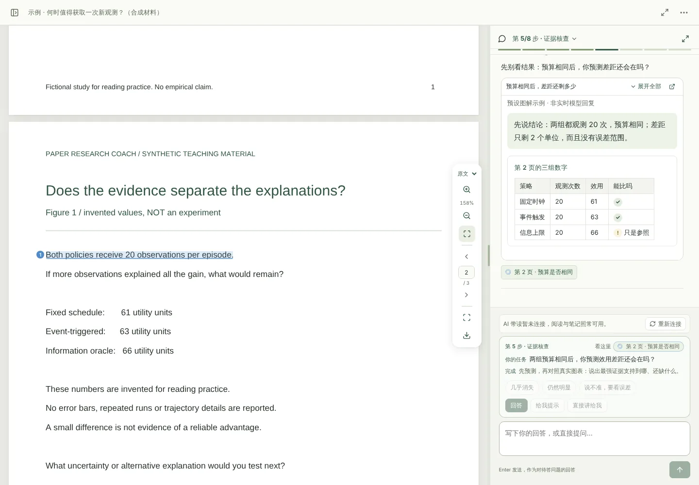
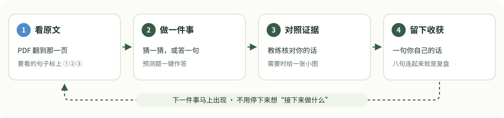
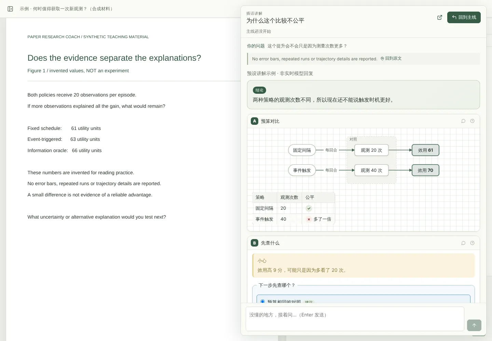
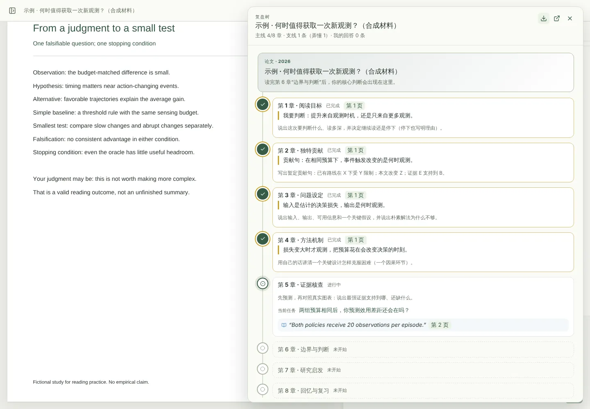

<div align="center">


# Paper Research Coach

### 不止读懂论文，形成自己的研究判断

本地 PDF 阅读工作台，加上一个能装进 Claude Code、Codex、Pi 的带读 Skill，以及可直接内置进 DeepSeek Harness 的插件版。<br>
教练把话说到原文那一句，一次只给一个小任务，判断留在你手里。

[](https://github.com/ooooooomygosh/paper-research-coach/actions/workflows/verify.yml)
[](https://github.com/ooooooomygosh/paper-research-coach/releases)
[](docs/QUICKSTART.md)
[](LICENSE)

**简体中文** · [English](README.en.md) · [快速上手](docs/QUICKSTART.md) · [阅读方法论](docs/METHOD.md) · [工作台指南](docs/WORKBENCH.md) · [DSH 插件](docs/DEEPSEEK_HARNESS.md) · [参与贡献](CONTRIBUTING.md)

</div>

<br>

<picture>
  <source media="(prefers-color-scheme: dark)" srcset="docs/images/mainline-dark.webp">
  
</picture>

<p align="center"><sub>真实界面，跟随系统深浅色 · 合成论文与明确标注的预设回复，非实时模型输出 · <a href="docs/SHOWCASE.md">如何复现</a></sub></p>

> [!NOTE]
> 预览软件，不是已验证的教学产品。最新安装包在 [Releases](https://github.com/ooooooomygosh/paper-research-coach/releases) 页面**最上面**的版本（预发布版，GitHub 的 “Latest” 标签不会指向它）。装好以后会自己更新。

## 它怎么带你读

<picture>
  <source media="(prefers-color-scheme: dark)" srcset="docs/images/loop-dark.svg">
  
</picture>

八章主线走完一篇论文：阅读目标、独特贡献、问题设定、方法机制、证据核查、边界与判断、研究启发、回忆复习。每章一个循环：翻到那段原文、做一个小任务、用原文核对、写一句你自己的收获。

读到一半冒出的问题挂在当时那一章下，成为支线；讲解在对话里展开成一页图文，哪块没懂就追问哪块。主线停在原处，弄懂了点“我弄懂了”再回去。八章走完，整轮阅读连成一棵复盘树，可以导出成离线 HTML。

没有经验值，也没有掌握度评分。完成一章只说明这一轮覆盖了这个判断。

<table>
<tr>
<td width="50%"></td>
<td width="50%"></td>
</tr>
<tr>
<td align="center"><sub>支线讲解展开在对话里，每块都能单独追问</sub></td>
<td align="center"><sub>复盘树：原文、你的回答、收获、支线，一棵树看完</sub></td>
</tr>
</table>

## 三种用法

| | 是什么 | 入口 |
|---|---|---|
| **工作台**（推荐） | 本机 PDF 阅读器 + 教练对话，标注、笔记、翻译、Zotero 同步都在这里 | [一行安装](#工作台) |
| **只装 Skill** | 在 Claude Code、Codex、Pi 里直接带读，用宿主自己的模型配置 | [两条命令](#只装-skill) |
| **DSH 插件** | 整套工作台内置进 DeepSeek Harness，用 Harness 登录账户读论文，不用 API Key、不用 Codex CLI | [安装方式](#deepseek-harness-插件) |

三种形态共用同一套阅读方法和同一份 Skill；工作台额外提供原文定位、标注和离线留存。

## 工作台

```bash
# macOS / Linux
curl -fsSL https://raw.githubusercontent.com/ooooooomygosh/paper-research-coach/main/scripts/install.sh | sh
```

```powershell
# Windows PowerShell（脚本尚未在 Windows 真机上验证，失败时按快速上手里的手动步骤）
irm https://raw.githubusercontent.com/ooooooomygosh/paper-research-coach/main/scripts/install.ps1 | iex
```

安装脚本会找到最新发布版、校验 SHA-256，再装进独立环境（有 [uv](https://docs.astral.sh/uv/) 用 uv，否则 pipx，再否则 `python -m venv`）。不需要管理员权限，不改书库和 shell 配置。

装完输入 `prc` 打开工作台 → 导入 PDF → 点“开始跟读”。AI 对话走本机已登录的 Codex CLI，登录一次即可；没有它，阅读、标注、笔记、导出照常可用。想先试：`prc-demo`（三页合成论文，不读取你的文献）。

工作台开着时每天最多检查一次更新，校验后在后台装好，没人阅读时自动切换；也可以 `prc update` 手动更新。卸载不会删书库，位置见 `prc doctor`。完整步骤、手动安装和 Windows 细节见[快速上手](docs/QUICKSTART.md)。

## 只装 Skill

Claude Code：

```text
/plugin marketplace add ooooooomygosh/paper-research-coach
/plugin install paper-research-coach@paper-research-coach
```

Codex、Pi 等其他宿主：

```bash
npx skills add oooooomygosh/paper-research-coach
```

然后附上论文，说：“带我读这篇论文，先从作者最关键的发现开始。” 不需要本项目的 Python、Node.js、Zotero 或单独的模型密钥。

不用 npx 的话，从 [Releases](https://github.com/ooooooomygosh/paper-research-coach/releases) 下载 `paper-research-coach-skill-*.zip`，把**完整文件夹**放进宿主的技能目录（Codex `~/.agents/skills/`、Claude Code `~/.claude/skills/`、Pi `~/.pi/agent/skills/`）。只复制 `SKILL.md` 不够，它需要同目录的 `references` 与 `assets`。

## DeepSeek Harness 插件

把整套工作台内置进 [DeepSeek Harness](docs/DEEPSEEK_HARNESS.md)，用 Harness 当前登录的 `deepseek-account` 调用模型：不需要 API Key，也不需要 Codex CLI。装好后从侧栏“论文研读”进入。

插件版本 **1.2.0**，基于工作台 **2.0.0rc14**，要求 Harness **0.2.1-rc.5**。

| 平台 | 安装 |
|---|---|
| Windows x64 | 安装包 `PRC-DSH-1.2.0-win-x64.zip`（约 476 MiB，由维护者构建分发，**不在 Git 里**；仓库的 wheel 与 Skill ZIP 不能代替它）。装好兼容的 Harness 并登录，退出应用后完整解压，运行 `安装.cmd`，重启点“论文研读”；卸载用同包 `卸载.cmd`，论文与学习记录保留 |
| macOS（Apple silicon） | 没有预打包产物，从源码构建并注册进 Harness profile：`ports/deepseek-harness/macos/install-macos.sh`，步骤与限制见 [macOS 说明](ports/deepseek-harness/macos/README.md) |

插件在保留原有阅读工作台的基础上多了两块内容：

- **知识库学习**（整合 [Learn from Materials](https://github.com/dmoshehun-prog/learn-from-materials)）：导入 PDF、DOCX、PPTX、EPUB 和文本材料，保留来源映射，生成学习页、概念与方法库、练习与错题，可追问、可停止恢复、可导出。
- **交互式讲解**（整合 [Answer me with HTML](https://github.com/QingYunA/answer-me-with-html)）：围绕问题、论文页或知识库生成流程图、时序图、公式、表格组成的页面，支持改草稿、换主题、存版本、导出 HTML。

教练默认用 **DeepSeek Flash + high 思考深度**；模型不支持该档位时不提交，失败时会说明具体原因（额度、限流、上下文等），不再只显示一句“回复未完成”。

数据默认在 `%USERPROFILE%\.dsh\paper-research-coach`，macOS 在 `~/.dsh/paper-research-coach`（设了 `DSH_HOME` 就跟它走）。从浏览器版升级时，`macos/import-legacy.sh` 能把旧库与翻译缓存整体迁进来。

> [!NOTE]
> 这是第三方适配版，不是 DeepSeek 官方发行。内置版关闭了独立工作台的自动更新；宿主升级后需要重新核对兼容性。逐字引文校验不等于语义完整性，扫描页与图内细节仍需人工核对，练习答案是模型生成的参考。

## 和“AI 总结论文”有什么不同

| | 常见的 AI 论文助手 | Paper Research Coach |
|---|---|---|
| 一次给你什么 | 一整页摘要 | 一处原文、一个任务、怎样算完成 |
| 谁下判断 | AI 直接给结论 | 先给暂定判断，再用原文核对；你可以要提示、要解释，或请它反驳你 |
| 证据在哪 | 难以回到出处 | PDF 自动翻到那一页并标出句子，每条消息和笔记都能跳回原位 |
| 读完留下什么 | 又一份总结 | 每步一句你的收获、未解问题和最小的下一步 |

## 数据与边界

- PDF 与阅读记录存本机，服务只监听回环地址。本地存储不等于离线 AI：启用教练或翻译时，相关内容会发送给你配置的模型服务。
- 更新检查每天最多一次匿名请求 GitHub 发布接口，不带论文、笔记或身份信息；自动安装只接受本项目发布且通过同一发布 `SHA256SUMS` 校验的包。关掉：设置 → 版本与更新，或 `PRC_NO_AUTO_UPDATE=1` / `PRC_NO_UPDATE_CHECK=1`。
- 教练要你读的句子必须在该页文字里逐字找到，找不到就不标；扫描页没有文字层时只翻到那一页。引文一致不等于语义判断正确，论证仍要你自己核对。
- Zotero 写入需要你明确授权；启动链接包含访问凭证，不要分享。见[安全指南](docs/SECURITY.md)。
- 目前没有学习收益的真人试验结论；不保证自动识别所有扫描 PDF；多附件的 Zotero 条目暂取首个 PDF，请核对原文版本。见[验证记录](docs/TESTING.md)与[审视清单](docs/FINAL-REVIEW.md)。

## 更多文档

| 文档 | 内容 |
|---|---|
| [快速上手](docs/QUICKSTART.md) | 手动安装、源码运行、Windows 细节、故障排查 |
| [阅读方法论](docs/METHOD.md) | 七条原则、八步路线，以及每条做法在工作台里变成了什么 |
| [工作台指南](docs/WORKBENCH.md) | 标注、笔记、翻译、Zotero 与目录同步、复盘与导出 |
| [DSH 插件](docs/DEEPSEEK_HARNESS.md) | Harness 适配版的入口、数据与构建方式 |
| [设计说明](docs/DESIGN.md) | 交互与实现上的取舍 |
| [测试与验证](docs/TESTING.md) | 自动化测试覆盖、截图复现、未验证项 |
| [参与贡献](CONTRIBUTING.md) | 开发环境、测试、提 Issue 时该写什么 |

路线图与优先级在 [Issues](https://github.com/ooooooomygosh/paper-research-coach/issues) 里讨论。

## 许可与致谢

原创代码与文档采用 [MIT](LICENSE)。引用本项目请用仓库侧栏的 “Cite this repository”（[CITATION.cff](CITATION.cff)）。阅读方法的来源见[来源与致谢](docs/SOURCES.md)，第三方组件署名见[讲解页与写作规则](docs/THIRD_PARTY_ANSWER_ME_WITH_HTML.md)和[翻译组件](docs/THIRD_PARTY_TRANSLATION.md)。
