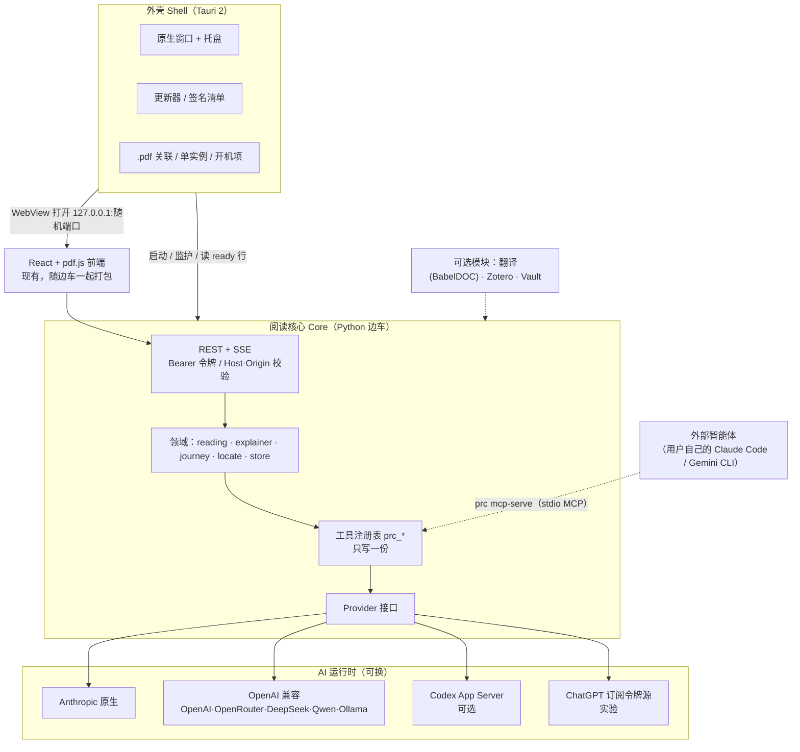
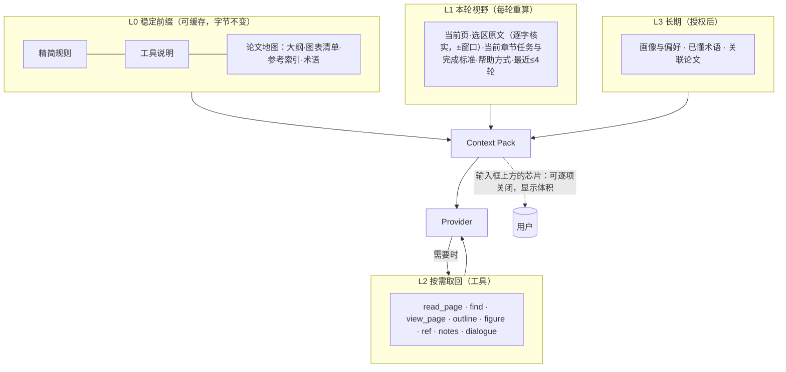

# 重构与跨端打包方案：从"终端 + 网页"到"一个能双击的 App"

> 状态：**提案**，尚未实现，没有改动任何代码。写于 2026-11-04。
> 证据标记：**✔** 我本人读过原文或实测；**◇** 调研代理读过原文、我未逐条复核；**△** 推断。
> 想直接看结论：读第 0 节，再看第 9 节的路线图。

## 0. 一页结论

**要解决的不是"开终端"这一个问题，而是三层耦合。** 只做一个桌面外壳，用户仍然得在终端里 `codex login`，那只是把终端藏了起来。

| 层 | 现在 | 要变成 |
|---|---|---|
| **外壳**（怎么打开） | 终端 `prc` → 起本地服务 → 浏览器标签页 | 一个能双击的 App：窗口、更新、`.pdf` 关联都由外壳管 |
| **AI 运行时**（谁来想） | 只认本机 Codex CLI 的 App Server（`coach.py` 的 `CodexRPC`） | 可换的 `Provider`：API Key / 本地模型 / Codex / 用户自己的 Claude Code |
| **阅读核心**（怎么教） | 已经很扎实：八章主线、支线、逐字定位、幂等存储、181 个测试函数 | **基本保留**，只补"论文地图"和"本轮上下文可见" |

**五个决定：**

1. **不重写。** 保留 Python 后端当"边车"（sidecar），外壳只负责启动它、开窗口、更新。理由：约 9.8k 行 Python + 181 个测试 + `pypdfium2` 逐字定位 + 隔离的 BabelDOC，重写成本远高于收益（✔ 仓库实测）。
2. **外壳先试 Tauri 2，设一个"不过关就换 Electron"的验收门。** 门的核心是 pdf.js 在各系统的 WebView 里表现一致（第 3.2 节）。外壳只有约百行，换起来便宜，前提是边车协议与外壳无关。
3. **AI 层抽成 `Provider` 接口，`prc_*` 工具只写一份。** 先做"API Key"（Anthropic 原生 + OpenAI 兼容，覆盖 OpenAI、OpenRouter、DeepSeek、Qwen、Ollama 等），Codex 退为可选适配器。
4. **每次提问的上下文由代码按"四层契约"组装，并且让用户看得见、关得掉。** 新增的关键一块是"论文地图"（大纲、图表清单、参考文献索引）。
5. **可视化只加能服务"读懂并形成判断"的几种**：论证地图、分面高亮、论文脑图、符号悬浮。不加没有出处的"好看图表"，更不加掌握度分数。

**最大的不确定项（不要当成定论）：**
- **Claude 订阅**这条路，Anthropic 明文禁止第三方应用提供 claude.ai 登录或转发订阅额度（✔ 第 4.2 节原文）。所以对 Claude 用户，合规的做法是反过来：让用户自己的 Claude Code 通过 MCP 来驱动本 App。
- "Tauri + 真实 Python 解释器"这个组合，调研代理**没有找到大型开源的现成例子**（◇）。所以路线图第 1 阶段先做一个小验证（spike），不是直接承诺。

---

## 1. 现状诊断

### 1.1 痛点在代码里长什么样

| 层 | 代码位置 | 现象 |
|---|---|---|
| 外壳 | `launcher.py`：`spawn_service` 以脱离终端的子进程起 `python -m paper_research_coach.cli serve`，固定端口 8765，令牌放 URL 片段，`webbrowser.open` | 能"双击"（`shortcut.py`），但本质仍是本机服务 + 浏览器标签；端口固定，与别的实例冲突 |
| 外壳 | `install.sh` / `install.ps1`、`updater.py`（pip 安装）、`relaunch.py`、`service.py`（仅 macOS launchd） | README 自己写明 Windows 脚本"尚未在真机验证" |
| AI | `coach.py:77` `CodexRPC` 启动 `codex app-server --stdio`；`coach.py:50` `codex_binary()` 在 PATH 和几个固定 macOS 路径里找 `codex`；`codex_text.py` 翻译也走它 | 没装并登录 Codex CLI，就没有 AI 带读 |
| 核心 | `reading.py`、`explainer.py`、`journey.py`、`locate.py`、`store.py` | 这部分与外壳、AI 都**没有**耦合，是资产 |

### 1.2 现在每一轮提问，模型到底知道什么（✔ 读过代码）

- **常驻**：`runtime_prompt.RULES`（约 3000 字，上限由 `bootstrap` 检查）+ 论文标题、页数、阅读目标、下一动作、未决问题。
- **每轮前缀**（≤300 字）：当前 PDF 页、是否换版、是否在追问某个讲解页、本轮意图（follow/answer/detour）、帮助方式；主线轮再附一张由代码生成的"本步方法卡"（`reading.turn_guide`）。
- **用户内容**：选中的原文、用户的话、可选的页面图。
- **其余全靠工具按需取**：`prc_read_page`、`prc_view_page`、`prc_find`、`prc_context`、`prc_list_notes`、`prc_read_dialogue`、`prc_resource`……
- **历史**由 Codex 原生线程持有，换模型服务时才用文字记录重建（`DESIGN.md`）。

**缺口**（也是下面第 5 节要补的）：
1. 模型没有"全文地图"。它想知道第几节讲什么、图 3 在哪页，只能 `prc_find` 瞎找。
2. 用户看不到"这一轮模型到底拿到了什么"，也没法增减。
3. 没有跨论文的长期记忆（用户已懂的术语、常犯的误解）。
4. 历史在 Codex 线程里，换 Provider 就要靠文字重放，这是一个可以主动设计的东西，不该是补丁。

---

## 2. 目标架构



**三条设计原则：**

1. **工具契约是中心。** `prc_*` 的处理函数只写一份，对外有三种出口：进程内函数（API Key 类 Provider）、`dynamicTools`（Codex）、stdio MCP（外部智能体）。以后换 AI 不动教学逻辑。
2. **我们自己持有对话历史。** 历史本来就存在 SQLite（`coach_messages`），Provider 无状态也能重放；换服务、换模型都不再是特例。
3. **外壳尽量薄，协议与外壳无关。** 外壳只做三件事：起边车、读到"就绪"、打开窗口。换成 Electron 只是换这百来行。

---

## 3. 打包与跨端

### 3.1 实测：边车有多重

我在一个干净的虚拟环境里装了 `pyproject.toml` 声明的核心依赖（不含翻译），Linux、Python 3.13（✔ 实测）：

| 项 | 大小 |
|---|---|
| `site-packages` 合计 | **120 MB** |
| 其中 `fontTools` | 29 MB |
| 其中 `cryptography`（`keyring` 在 Linux 上带入） | 16 MB |
| 其中 `pip` | 13 MB |
| 其中 `pillow.libs` + `PIL` | 21 MB |
| 其中 `pypdfium2_raw` | 8 MB |

三个观察：
- **`fonttools` 声明为核心依赖，但我在仓库所有 `.py`、`.toml`、`.md` 里搜不到任何 import**（✔ grep）。很可能可以直接从核心依赖里删掉，**删之前请确认**翻译环境是否另有需要。
- 去掉 `fontTools`、`pip`、Linux 专用的 `cryptography` 后约 **62 MB**（120 − 29 − 13 − 16，算术结果）。macOS/Windows 没有 Linux 的 `cryptography`，预计更小（△，没在这两个系统上测）。
- **BabelDOC 的体积我没测成**（安装被我中止了），所以不给数字。好消息是代码里翻译**已经**跑在数据目录下独立的 `babeldoc-env` 解释器里（`translation.py:400` 附近，✔），也就是"可选重模块、按需下载"的形态本来就有。

### 3.2 外壳：Tauri 2 优先，Electron 兜底

| | Tauri 2 | Electron |
|---|---|---|
| 外壳体积 | 小（系统 WebView） | 大（自带 Chromium；Open WebUI Desktop 安装包约 125–129 MB ◇） |
| 引擎一致性 | **不一致**：macOS=WKWebView，Windows=WebView2，Linux=WebKitGTK | 一致（Chromium） |
| 开发门槛 | 外壳要 Rust，但只有百行 | 全 JS/TS，贴合现有团队技能 |
| 先例 | Readest（Tauri 2 + pdf.js，含移动端）◇ | **DeepTutor 桌面版**（Electron + 内置 Python，标注 Preview）◇ |
| 更新 | `tauri-plugin-updater`：自带密钥签名、静态 `latest.json` 可放 GitHub Releases ◇ | `electron-updater`；macOS 自动更新必须已签名 ◇ |

**为什么要设验收门：** 这个产品最精细的部分是 pdf.js 阅读器（连续滚动的虚拟化、双指缩放、选区标记与文字层偏差实测小于 2 px，见 `DESIGN.md`）。WebView 引擎不同，这些最容易出细微偏差。Linux 的 WebKitGTK 尤其值得警惕（Readest 在 Linux 上改用了 CEF，这暗示有坑，但属推断 △）。

**第 1 阶段的小验证（spike）通过标准**——任何一条在任一系统失败，就换 Electron：

1. 在 macOS / Windows / Linux 上跑现有前端：连续滚动、双指缩放、选区①②③标记与文字层偏差仍 ≲ 2 px。
2. 边车冷启动 < 3 秒（mac/win）；关闭窗口不留孤儿进程；边车崩溃能被检测并重启。
3. 从图形界面启动（PATH 极简）也能找到 `codex`（DeepTutor issue #2340 就是这个坑 ◇；做法：用登录 shell 取 PATH）。
4. 单实例；双击/拖拽 `.pdf` 能打开（Windows/Linux 要自己从 argv 读路径，Tauri 的 `Opened` 事件只在 macOS/移动端触发 ◇）。
5. 签名更新、失败回滚走通一次完整流程。
6. 旧版 `prc`（固定 8765）与新 App 共用同一个数据目录时，SQLite 不被两个后端同时写坏（加目录锁 + 版本守卫）。

### 3.3 边车怎么打包

- **推荐**：`python-build-standalone` 的 onedir 目录 + 预装 wheel，保留 `python -m paper_research_coach` 的启动方式（DeepTutor 也是用 `uv python install` 装真解释器 ◇）。
- **不推荐 PyInstaller onefile**：调研读到的示例称 Tauri 的 `process.kill()` 只杀得掉 bootloader、杀不掉真正的子进程；onefile 每次启动要解压，Windows 上还会被杀软扫描变慢；winget 提交会过多款杀软，误报会被拒（◇）。
- **启动协议**（替换固定端口 8765）：

  ```text
  外壳  →  起边车： --port 0   环境变量 PRC_TOKEN=<随机>   --data-dir <D>
  边车  →  stdout 第一行： {"ready":true,"port":53211,"version":"2.1.0"}
  外壳  →  窗口打开 http://127.0.0.1:53211/#token=…
  退出  →  外壳杀整个进程组（让 SQLite WAL 正常 checkpoint）
  ```
  沿用现有的 Bearer 令牌 + Origin/Host 校验（✔ `server.py:138`）。
- **从仓库里可以删掉的"生命周期代码"**：`launcher.py`(142) + `relaunch.py`(35) + `shortcut.py`(55) + `service.py`(78) + `updater.py` 的 pip 路径(226) ≈ 540 行，加 `install.sh`/`install.ps1`/`open-workbench.command`。全部由外壳接管。
- **只留一套更新机制**：桌面版用外壳更新整包（边车一起换）；旧的 pip 更新只留给纯 CLI 用户，避免两套并存。DeepTutor 的做法值得抄：用 Ed25519 签名的 core 包、失败回滚、更新 core 不必重装壳（◇；它的"自动发现更新"也还没接通，说明这块确实费劲）。
- **可选模块**：翻译（BabelDOC，AGPL ◇）做成"设置里点一下再下载"的组件；Zotero、Vault 同理。核心包保持小。

### 3.4 签名与分发（和钱、和用户体验直接相关）

| 平台 | 不签名会怎样 | 要花什么 |
|---|---|---|
| macOS | Gatekeeper 拦截，要右键打开；Developer ID 分发必须公证 ◇ | Apple Developer $99/年 ◇ |
| Windows | SmartScreen 警告；EV 证书也不再自动免警告，信誉靠下载量慢慢积累 ◇ | Azure Artifact Signing 约 $9.99/月起，**个人开发者仅限美/加**，所以你所在地是否可用需要核实 ◇；SignPath Foundation 对开源免费（二手信息，需核实）◇ |
| Linux | 无签名问题 | AppImage / .deb；Flathub 要求从源码构建，带解释器的边车很难上架 △ |

**建议**：第一批预览版**先不签名**，在 README 里写清楚绕过步骤（DeepTutor 的桌面预览也是 macOS ad-hoc 签名、Windows 未签名 ◇）。有真实用户后再买签名。分发先走 GitHub Releases；winget/Homebrew 以后再说。

### 3.5 平板与手机

- **手机原生版不现实**：Python 边车跑不进手机；Tauri 的 sidecar 在移动端不被支持（依据是 beta 期的 issue，二手 ◇）。
- **平板可行的路**：桌面 App 当"主机"，平板用 PWA 当瘦客户端（读 PDF、划线、做任务卡），AI 仍在主机上跑。要做的事：
  1. 放开 `server.py` 里只允许回环的 Host 校验，改成"已配对设备"白名单（现在是硬拒绝，✔）。
  2. 配对：二维码 + 一次性码 → 设备令牌。
  3. HTTPS：PWA 要求 HTTPS 或 localhost（MDN ◇）；`tailscale serve` 默认自动签证书、只在你的 tailnet 内可见（◇）。
- 放到第 3 阶段，前提是桌面版稳了。

---

## 4. AI 运行时：把 Codex 从"唯一"变成"其中之一"

### 4.1 Provider 接口（草图，接口名是我拟的）

```python
class Provider(Protocol):
    caps: Caps          # tools · vision · tool_result_image · structured_output · max_images
    async def turn(self, session, user: list[Part], tools: list[ToolSpec],
                   system: str, schema: dict | None = None) -> AsyncIterator[Event]: ...
        # Event = TextDelta | ToolCall(id, name, args) | Usage | Done | Error
    async def tool_result(self, session, call_id, parts: list[Part], is_error=False): ...
    async def interrupt(self, session) -> None: ...
    def snapshot(self, session) -> dict: ...        # Codex thread_id / 自持消息列表
    async def restore(self, snap) -> Session: ...   # thread/resume 或 重放
    async def status(self) -> AuthStatus: ...       # 有没有 key / 登录 / 可用模型

# prc_* 处理器只写一份，三种出口：
#   进程内函数（API Key 类）· dynamicTools（Codex）· stdio MCP `prc mcp-serve`（外部智能体）
# caps.tool_result_image 为假：图改成追加一条 user 图片消息
# caps.vision 为假：prc_view_page 退化为 prc_read_page 文本
```

参考：DeepTutor 用声明式 `ProviderSpec` 注册表加按模型的能力表（`supports_vision / supports_tools / supports_streaming`），并缓存 `tool_choice` 失败（◇）。2026-04 它把 litellm 换成了原生 OpenAI/Anthropic SDK，原因未见说明（◇）。

### 4.2 认证路线：谁能用、合不合规

| 路线 | 谁能用 | 合规情况 | 阶段 |
|---|---|---|---|
| **A. API Key**（Anthropic、OpenAI、OpenRouter、DeepSeek、Qwen…） | 有 key 的人 | 无风险 | **P1** |
| **B. 本地模型**（Ollama / LM Studio 的 OpenAI 兼容接口） | 有算力的人 | 无风险；但能力会降（见下） | **P1** |
| **C. "用 ChatGPT 登录"用订阅额度** | ChatGPT 付费用户 | OpenAI 文档写明开源/本地应用可以请求使用用户的 ChatGPT plan 额度发起合格的 Responses API 请求；付费或托管应用要另填表。✔ 我读了这个入口页，但它引用的 **Preview limitations 页我没读**，所以按"实验"对待 | P3 |
| **D. 已装的 Codex CLI**（现状） | 开发者 | Codex 文档称 App Server 的认证"从未被允许用于商业或托管服务"（◇）。本地开源应用继续用没问题，但 `dynamicTools` 要 `experimentalApi`，schema 随 CLI 版本漂移（◇） | 保留为高级选项 |
| **E. Claude 订阅** | Claude Pro/Max 用户 | 见下方原文，**不能由我们的 App 提供** | 只做 MCP 反向模式 |

**Anthropic 原文**（✔ `code.claude.com/docs/en/legal-and-compliance`）：

> Anthropic does not permit third-party developers to offer Claude.ai login into their own applications, or to route requests through Free, Pro, Max, or Ultra plan credentials on behalf of their users. Moreover, developers may not collect, store, or intermediate Claude.ai credentials or session tokens.
>
> Nor does it prevent an end user from signing in to the unmodified Claude Code binary with their own Claude subscription…

所以：
- **不要**把 Agent SDK 嵌进 App 并让用户用订阅登录。
- 合规的 Claude 订阅用法是**反过来**：让用户自己的、未改动的 Claude Code 通过 `prc mcp-serve` 来驱动我们的阅读器（`prc_show` 就是让 App 翻页并标句）。这是"智能体托管工作台"，与现在"工作台托管智能体"互补。
- ACP（Zed 的 Agent Client Protocol）适配器能让 App 驱动 Claude Code/Gemini CLI，但：内置的 shell/文件工具关不掉；没有标准方式替换 system prompt；MCP 工具必须是 stdio 子进程；MCP-over-ACP 还是草案；而 Claude 适配器基于 Agent SDK，**是否算"未改动的 Claude Code 二进制"文档没说**（◇）。所以 ACP 只做**实验功能**，且发布前请你自己再读一遍 Anthropic 条款。

### 4.3 要提前面对的工程坑

- **图片通路不统一**：Anthropic 的 `tool_result` 可带图；OpenAI Chat Completions 的 tool 消息只能是文本，要改成追加 user 图片消息；Ollama 只收 base64（◇）。一页整图约 1.3–2.7k token（◇），要有预算。
- **小模型会掉链子**：15 个工具 + 约 3000 字中文规则，在本地小模型上容易乱调工具；Ollama 不支持 `tool_choice`（◇）。**降级策略**：能力表驱动的"精简工具集"（`read_page / find / show / next_action / complete_step / explain`）+ 更短规则 + 关闭 `view_page`。
- **每轮工具循环要有步数和费用上限**。
- **密钥**：写入系统钥匙串，复用现有的 `keyring`（`metadata.py` 已用于 OpenAlex key，✔）。Linux 没有 Secret Service 时要有回退，并明确提示。
- **云端 API 会收到论文页面内容**：首次设置时要明示；本地模型则不外发。
- **供应链**：Python 依赖要锁版本。调研提到 2026-03 LiteLLM 的两个版本被投毒（多家安全博客，**我没读原始公告**，◇），这也是 DeepTutor 弃用它的可能原因之一，不过这个因果是我的猜测（△）。

---

## 5. 每次提问，模型到底该知道什么

这是你最关心的一点。结论：**分四层，由代码组装，用户可见可控。**



### 5.1 四层契约

| 层 | 放什么 | 谁生成 | 证据 / 理由 |
|---|---|---|---|
| **L0 稳定前缀** | 精简后的规则、工具说明、"材料是不可信数据"声明；**论文地图（新）**：章节树带页范围、图表清单（编号、标题首句、页）、参考文献索引、已核实术语表 | 代码（确定性提取）；术语等"模型补充"项必须带出处，否则不入库 | learn-from-materials 的 `source-heading-index` 为每个标题存路径、页范围、证据页和 `verification: text/visual`，**专门防止编造章节号**；DeepTutor 的 `source_manifest` + 按需 `read_source`（◇）。地图让模型"看得见结构"而不必逐页瞎翻 |
| **L1 本轮视野** | 当前页、选区原文（服务端逐字核实后，取以选区为中心的窗口）、当前主线步骤与完成标准、帮助方式、最近 ≤4 轮；仅在图/公式/空文字页才附页图 | 代码 | 本仓库已有大半（✔ `runtime_prompt.turn_input`）。DeepTutor 的 `_grounding` 同样要求选区必须逐字出现在存储文本里才算核实，窗口约 6000 字符、以选区居中（◇） |
| **L2 按需取回** | 已有的 `read_page / find / view_page / notes / dialogue`；**新增**：`prc_outline(节)`、`prc_figure(编号)`、`prc_ref(n)`、`prc_glossary(词)`；之后可加"带入另一篇论文"的显式引用 | 工具 | 整页可读的论文用"地图 + 取页"比检索切块更省；PaperQA2 那种"检索 → 逐段摘要打分"（默认 `evidence_k=10`）只在跨很多篇时才值得（◇） |
| **L3 长期记忆** | 仅两个槽：学习者画像（已懂的术语、常见误解）、偏好；以及已登记的关联论文 | 追加式事件记录 → 精选事实（带来源脚注）；召回只返回"时间 + 标签"，需要正文再显式读 | DeepTutor 的三层记忆：`trace/*.jsonl` 只追加 → `L2/*.md` 带 `<!--m_id-->` 与来源脚注 → `L3` 综合；`recall.py` 不回传正文（◇）。**不做隐藏的向量库**，与本仓库"用户原话逐字保留、AI 评论独立"的原则一致；沿用现有 `note_consent` / `learning_consent` |

### 5.2 回答的"出处标签"

借 learn-from-materials 的答题协议（◇）：每个断言归入 `[材料依据]`（带页码）/ `[材料未覆盖]` / `[模型补充]` / `[外部核验]`。"模型补充只存在于当前对话，不写回来源事实"。这和本仓库已有的"作者主张 / 实际证据 / 用户原话 / 推测"四分法天然对齐，建议在规则里统一用词，并在界面上用小标签显示。

### 5.3 让用户看得见：本轮上下文芯片

输入框上方一排可开关的芯片，例如：`第 5 页` `选区 38 字` `任务：证据核查` `论文地图` `笔记×3` `引用 [12]`，每个带体积，可"只用这一轮"或"固定"。

- DeepTutor 的 `+` 引用菜单区分"本轮一次"和"每轮固定"（◇）；Open Notebook 对每个来源给三档（全文 / 仅摘要 / 不纳入），并显示 token 数（◇）。
- 这同时回答了"AI 凭什么这么说"，也是本仓库"判断留在你自己手里"的自然延伸。

### 5.4 明确不给模型的

| 不给 | 理由 |
|---|---|
| 整本全文、全部笔记 | 现有预算机制已管（`coaching_context.py`，36000 字符上限） |
| 磁盘路径 | 已 `pop("source_path")`（✔） |
| 掌握度分数 | DeepTutor 的 Mastery Path 提示只读 waypoint 的 status 字符串、"不读分数"（◇）；本仓库也明确"没有掌握度评分" |
| 下一章的结论 / 参考答案 | 在 hint、challenge 模式且用户未作答前不放（△） |
| 材料里的任何指令 | 一律当数据（已是现行原则） |
| 把"模型补充"写回来源事实库 | 来源与合成必须分开 |

### 5.5 省 token 的三个做法

1. **同名的运行时块只保留最新一份快照**（DeepTutor `split_for_replay` ◇）。
2. **动态内容放在末尾的 user 消息，不碰 system**，让前缀缓存命中（DeepTutor 把知识库检索结果放末尾 ◇）。
3. **不采用** Anthropic Citations API 来替代 `prc_show`：它与结构化输出互斥（返回 400，◇），而我们的 `locate.py` 本来就在服务端逐字定位，更强。

### 5.6 一个可选的小设计

DeepTutor 的"猜你想问"：只用选区（≤2000 字）、附近文字（≤2400 字）、最近 4 轮，输出一句学习者口吻的问句（≤44 个汉字、必须以问号结尾、丢弃"因为/总之"这类答案式措辞），缓存 30 分钟（◇）。放在输入框 placeholder 里，很契合"一次一个小任务"。

---

## 6. 可视化：加什么，不加什么

现有（✔）：`flow / sequence / tree / timeline / callout / ask / kv`、表格、KaTeX 公式、dagre 布局；PDF 上的①②③标记；复盘树。

**判断标准**：每个新原语必须（a）服务"读懂并形成判断"，（b）自带出处，（c）不引入分数。

| 优先级 | 原语 | 教学作用 | 实现提示 | 许可 / 体积 | 来源 |
|---|---|---|---|---|---|
| **P1** | **论证地图 `map`**：节点分"主张 / 证据 / 假设 / 局限"，边分"支持 / 反驳 / 依赖"；**实线 = 材料有逐字引文，虚线 = 推断；没有证据的边不画** | 把"贡献—证据—边界"从文字变成可检查的结构 | 复用现有 dagre + SVG 渲染；边字段取 learn-from-materials 的 `evidence`(material/inference) 子集 | 已有依赖 | learn-from-materials 关系边规则 ◇ |
| **P1** | **分面高亮层**：目标 / 方法 / 结果 / 新意 / 局限，密度可调 | 先扫一遍再决定读不读（对应"速读"） | 存成独立 JSON 覆盖层，不改 PDF；与①②③并存 | 无新库 | Scim ◇；PDF++ 的"颜色当类别、不改 PDF" ◇ |
| **P2** | **论文脑图**：由论文地图的大纲一键生成，点节点跳页 | 一眼看全篇结构；也是 L0"地图"的可视化——读者看到的就是模型看到的 | `markmap-view`（MIT，解包约 86 KB，依赖 d3；`markmap-lib` 约 741 KB 仅构建期转换） | MIT | 调研代理实测包大小 ◇ |
| **P2** | **符号 / 术语悬浮** | 方法类论文最大的卡点是符号 | KaTeX `\htmlData` 给符号打标，悬浮出"定义 + 原文句"；该命令需 `trust`，只放行这几个 | KaTeX 已有，MIT | ScholarPhi ◇ |
| **P2** | **引用预览**：悬浮 `[12]` 显示参考文献条目 | 现在是"点击跳过去再返回"，可再减一步 | 复用参考文献索引 | 无新库 | CiteSee / ScholarPhi ◇ |
| **P3** | **图表证据卡**：区域截图 + "声称 / 证据 / 限度"三栏，可先预测再揭晓 | 对应"读证据之前先有判断" | 用 pdf.js 缩放无关坐标存区域 | 无新库 | react-pdf-highlighter-extended 的坐标存法（只借思路）◇ |
| **P3** | **结果小图 `chart`**：数字取自表格并带出处 | 比较基线与预算 | 手写 SVG 即可 | — | — |
| P3 | 支线合并成"综述卡" | 复盘 | 接在复盘树上 | — | study-tool ◇ |

**不引入**（调研代理查过许可与体积，◇）：Mermaid（解包约 123 MB）、Excalidraw（约 46 MB）、tldraw（生产环境要付费 license key）、elkjs（EPL/GPL）。React Flow（MIT，约 1.2 MB）只在确实需要拖拽、折叠时再上。

**许可提醒**：llm-for-zotero、PDFMathTranslate、Khoj、Obsidian Copilot 是 AGPL，**只借想法，不拷代码**，以免与本仓库 MIT 冲突。

---

## 7. 思想层的重构：五个名词

这套思想已经很清楚了。重构不是推倒，而是**给已有的东西起稳定的名字、划清边界**，这样记忆、同步、导出才有共同基础。

| 名词 | 含义 | 现有对应（✔） |
|---|---|---|
| **Source 来源** | 某一版论文 + 它的结构 + 可逐字定位的锚点 | `paper` 记录、`source_version`、`anchor`、`locate.py`；**新增"论文地图"** |
| **Move 动作** | 教练提出的一个小任务，带完成标准（主线一章 = 一串 Move；支线 = 一个 Move） | `reading.STEPS/CHECKS`、`coach_explainers` 的 quest |
| **Judgment 判断** | 学习者自己的话，逐字、可修订，链接到证据锚点 | `note(author=user)`、`takeaway`、`review` |
| **Exhibit 展品** | 由草稿渲染出的图文页，始终带出处 | `explainer.py` 产出的 doc JSON |
| **Trace 轨迹** | 只追加的事件流：回合、工具调用、展示的锚点、判断 | `coach_messages`、`operations`、`history` |

**投影**：复盘树、任务日志、导出、长期记忆都是 Trace 的投影（`journey.py` 已经是"只复制已有记录、不让模型总结"的投影，✔）。

好处：（1）记忆有了明确来源，可审计；（2）将来多设备同步只需合并追加式事件（`operations` 表已有幂等的操作 ID）；（3）换 Provider 不丢历史。**这是第 4 阶段的可选项，不是前置条件。**

---

## 8. 从参考项目借什么

| 项目 | 是什么 | 借什么 | 许可 |
|---|---|---|---|
| [learn-from-materials](https://github.com/dmoshehun-prog/learn-from-materials) | 把资料做成可追溯知识库的 Agent Skill | 标题索引防编造章节；**来源 / 模型补充分开**的四种标签；关系边必须带逐字引文、没有就写 unknown；"快速 / 系统"两档深度；方法卡带版本和父引用；"应用前先判断是否适用" | MIT |
| [DeepTutor](https://github.com/HKUDS/DeepTutor) | 智能体原生的学习工作台（约 54.8k star） | 每轮 `UnifiedContext` 与分块系统提示；**"引用"只传 ID、服务端按权限重取文本**；三层可审计记忆；Provider 注册表 + 能力表；Electron + 内置 Python 的桌面打包与签名更新；"猜你想问" | Apache-2.0 |
| PaperQA2 | 检索增强的论文问答 | 引用带页码范围；撤稿检查；检索 → 摘要打分 | Apache-2.0 |
| Open Notebook | NotebookLM 类应用 | 每个来源三档上下文 + token 计数 | MIT |
| Obsidian PDF++ | PDF 批注 | 高亮是链接、不改 PDF；颜色当类别 | MIT |
| Kotaemon | 文档问答 | 引用带相关度分数，在 PDF 里高亮 | Apache-2.0 |
| Gloss / study-tool | 论文阅读工具 | 框选截图入对话；译文逐句缓存；树形对话从选区分支 | 未显示 |
| ScholarPhi / Scim / CiteSee / Paper Plain / Semantic Reader | 增强阅读的研究原型（CHI / IUI） | 术语符号位置敏感定义；分面高亮；个性化引用标记；白话摘要 | 论文 |

Anthropic 的"学习模式"、OpenAI 的"学习模式"、Google 的"引导学习"：调研代理没能读到公开的提示词全文（页面 404/403 或只有宣传），**所以我没有把它们当证据用**。

---

## 9. 路线图

按**依赖顺序**排列，每一步都能单独发布，旧用户不受影响。规模用 S/M/L 表示，因为我不知道你的节奏。

### 阶段 0：解耦（M）· 外观不变，只改内部
- 抽出 `Provider` 接口，把 `CodexRPC` 放到接口后面；工具注册表独立成模块。
- 加一个 `FakeProvider`，让 181 个测试函数不依赖 Codex 也能跑。
- 边车支持 `--port 0` + stdout 就绪行 + 环境变量令牌。
- 确认并删除 `fonttools`；把重依赖标成可选。
- **验收**：现有测试全绿；`prc` 行为不变。

### 阶段 1：无终端 + API Key（L）
- 第 3.2 节的 spike → 选定外壳 → 出 macOS / Windows 预览版（不签名）。
- 首次启动向导：选 AI 来源（API Key / 检测到 Codex / 检测到 Ollama / 先不用 AI）→ 测一次连接 → 密钥进钥匙串。
- 实现 `AnthropicNative` 与 `OpenAICompat`，带能力表与降级。
- 外壳更新（签名清单 + 回滚）。
- **验收**：一台没有装 Python、没有终端经验的机器，下载 → 双击 → 填 key → 读完一章。

### 阶段 2：上下文与可视化（L）
- 论文地图（大纲、图表清单、参考索引）+ L0/L1 组装 + 本轮上下文芯片 + 出处标签。
- `map` 论证地图、分面高亮、论文脑图。
- 长期记忆 v1（仅画像与偏好两个槽，带来源脚注，用户可查看、可删除）。
- 可选：猜你想问。
- **验收**：同一个问题，对比有无地图时模型"瞎找页"的工具调用次数；用户能说出"这一轮它看了什么"。

### 阶段 3：生态与跨端（L）
- `prc mcp-serve`（让用户自己的 Claude Code / Gemini CLI 驱动阅读器）。
- ChatGPT 订阅令牌源（先读完 Preview limitations）；ACP 实验适配器。
- 翻译等做成可下载模块。
- 平板 PWA + 配对 + Tailscale。
- **验收**：iPad 读论文、做任务卡，AI 回复来自桌面主机。

### 阶段 4：可选
- Trace 事件化、多设备合并、Zotero/Vault 移成独立模块。

---

## 10. 风险登记

| # | 风险 | 缓解 |
|---|---|---|
| 1 | **WebView 差异**让 pdf.js 阅读器出现细微偏差（尤其 Linux WebKitGTK） | 第 3.2 节验收门；不过就换 Electron，边车协议不变 |
| 2 | **信任链**：嵌入式 Python 里大量二进制要逐个签名、公证；Windows 误报与 SmartScreen | 预览版先不签名并写清绕过步骤；有用户后再买；避免 PyInstaller onefile |
| 3 | **条款漂移**：Anthropic 禁第三方订阅登录；OpenAI 的订阅额度仍是限定范围；Codex `dynamicTools` 是实验接口 | 主推 API Key；订阅类全部标"实验"；发布前重读条款 |
| 4 | **工具调用可靠性**：15 个工具 + 长中文规则在小模型上会失控；各家对 `tool_choice` / 结构化输出支持不一 | 能力表驱动的精简工具集；每轮步数上限；`FakeProvider` + 场景评测（现有 `evals/`）覆盖 |
| 5 | **代码里的旧假设**：`sys.executable -m` 自启动、pip 式自更新、回环 Host 校验、固定端口 8765 | 阶段 0 先清；只留一套更新机制 |
| 6 | **GUI 启动时 PATH 极简**，找不到 `codex` | 登录 shell 取 PATH；设置里允许手动指定路径 |
| 7 | **两个后端共用一个 SQLite 数据目录**（旧 `prc` + 新 App） | 目录锁 + 版本守卫；迁移前自动备份 |
| 8 | **隐私**：云端 Provider 会收到论文页面与图片 | 首次设置明示；本地模型选项；不在日志里记正文 |
| 9 | **维护面**：新增 Rust 外壳 + 多平台 CI + 签名 | 外壳保持百行；CI 先只出 mac/win；Linux 后补 |
| 10 | 每次发版要上传 100–200 MB；BabelDOC 为 AGPL 且体积大 | 翻译做成按需下载的独立组件，不进主包 |

---

## 11. 需要你拍板的问题

我按下面的**默认假设**写了方案；任何一条不对，路线图要相应调整。

1. **目标用户有 API Key 吗？** 默认：有一部分，但很多学生只有订阅。→ 如果大多数人没有 key，ChatGPT 订阅令牌源（C）和"保留 Codex"的优先级要提前，且阶段 1 的向导要更重视"先不用 AI 也能读"。
2. **平台优先级。** 默认：macOS 与 Windows 先，Linux 后补；平板只做第 3 阶段。→ 如果 Linux 很重要，直接用 Electron 更稳。
3. **愿意为签名付费吗？** 默认：先发未签名预览。macOS 约 $99/年；Windows 方案受所在地限制，需要你核实。
4. **还保留"只装 Skill"那条分发渠道吗？** 默认：保留，它零安装；阶段 3 的 MCP 模式与它互补。
5. **长期记忆愿意做到什么程度？** 默认：只做画像与偏好两个槽，用户可见可删，沿用现有授权开关。

---

## 附录：怎么得到这些结论

- **✔ 我本人**：通读了仓库的 `README`、`docs/DESIGN.md`、`launcher.py`、`coach.py` 的 `CodexRPC` 与工具定义、`runtime_prompt.py`、`coaching_context.py`、`coaching_request.py`、`server.py` 的中间件与路由、`reading.py`、`explainer.py`、`journey.py`；实测了核心依赖体积；读了 Anthropic 合规页与 OpenAI 的开源应用页；用网页摘要读了 DeepTutor 与 learn-from-materials 的 README。
- **◇ 调研代理**：三个并行的只读调研（桌面打包、AI 运行时、阅读体验与上下文）读了各项目的源码与文档。我只核对了其中最影响决策的两条（Anthropic 与 OpenAI 的认证条款）。
- **没做到的**：BabelDOC 体积没测成；没有在 macOS/Windows 上跑任何东西；没有写任何实现代码；Anthropic/OpenAI/Google 的学习模式提示词没能读到。
