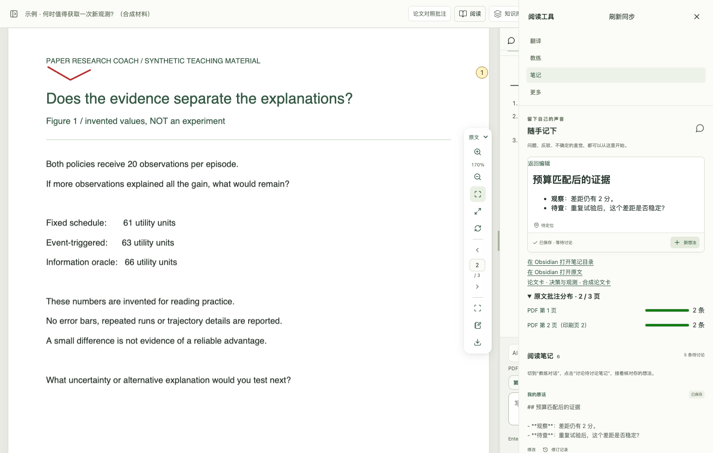

# DSH 1.4.0 · 在 PDF 旁边写笔记

在 Harness 侧栏打开「论文研读」。从 PDF 选词、画线、写 Markdown 到导出可重开的 PDF 副本，都可以在这个窗口完成。

截图中的文字、论文和数据为软件测试样例。

| 要做的事 | 入口与保存位置 |
| --- | --- |
| 选词读释义 | 在 PDF 文本层选词后点「查词」。macOS 优先使用系统已启用的词典，结果直接显示在选区旁。 |
| 手绘、查找批注 | 点 PDF 工具栏的笔形按钮，在原文或已定位的译文上画线。阅读工具中的「笔记」能列出原文各页的已定位批注。点击页码回到证据。 |
| 保存带批注的 PDF | 点 PDF 工具栏的下载按钮。笔迹作为标准 Ink 批注写入副本，可以在其他阅读器中继续查看。 |
| 填表、打印 | 打开「高级 PDF 工具」，在内置的 Mozilla PDF.js 阅读器填写表单，用其保存按钮下载当前编辑版本。此模式打开当前 PDF 文件；工作台中新增的手绘和笔记由工作台下载按钮导出。 |
| 阅读扫描页 | 在阅读工具中的扫描页提示点「识别本页文字」。macOS 使用本机 Apple Vision 识别中英文；其他平台可使用系统 Tesseract，语言包由 PRC_OCR_LANG 选择。知识库导入会保留原文字层并识别缺少文字的页。 |
| 在 DSH 写 Obsidian 笔记 | 在「笔记」输入 Markdown，预览标题、列表、表格和公式。完成目录同步设置后，编辑内容进对应的 Markdown 文件。面板可打开关联论文卡、笔记文件和 Zotero 条目。 |

### 性能与验证

- macOS Apple silicon，Harness 0.2.2-rc.1。一次合成扫描页首次识别约 1.8 秒，同一内容再次读取约 1 毫秒。混合 PDF 中的英文文字层和中英扫描页均按页提取。本机 OCR 结果需要对照原图，特别是公式和表格。
- 同一份 13.4 MiB 双语映射，在同一进程中首次建立索引约 192 毫秒，随后重复取页约 0.01 毫秒。旧版每次解析整份映射约 188 毫秒。数字仅计读取和索引。
- 240 段合成单句对齐，旧版约 178 毫秒，新版约 7 毫秒，输出内容一致。该用例测量写入检查点的开销。翻译模型的响应时间另计。
- 一页合成论文，在同机使用固定翻译应答比较 BabelDOC 处理，用时从 15.68 秒变为 14.38 秒，两份导出文件的逐页文字均一致。实时账户另行通过生成中文及双语 PDF 的冒烟测试。篇幅、排版、模型和网络会影响耗时。
- 在 Chromium 中通过 DSH 代理验证了笔记保存、重载、批注跳页、系统查词、手绘后下载和 PDF 表单保存。打印验证覆盖调用浏览器打印入口。高级视图按需加载本地资源。

### 安装

下载本次 Release 的 **PRC-DSH-1.4.0-mac.zip**，完整解压，退出 Harness 后运行「安装.command」。装有 1.3.1 的用户也可以在「设置 → 版本与更新」检查并暂存更新，完全退出后重新打开应用。安装包面向 macOS arm64。另附 SHA256SUMS 及自动更新清单。

高级视图使用随包分发的 PDF.js 6.3.289。首次从源码构建需要获取固定摘要的 Mozilla 发行包，离线构建可通过 PRC_PDFJS_VIEWER_ZIP 指向同一文件。[Mozilla 发行说明](https://github.com/mozilla/pdf.js/releases/tag/v6.3.289) · [Apple Vision 文档](https://developer.apple.com/documentation/vision/recognizing-text-in-images) · [Obsidian URI](https://obsidian.md/help/uri)
