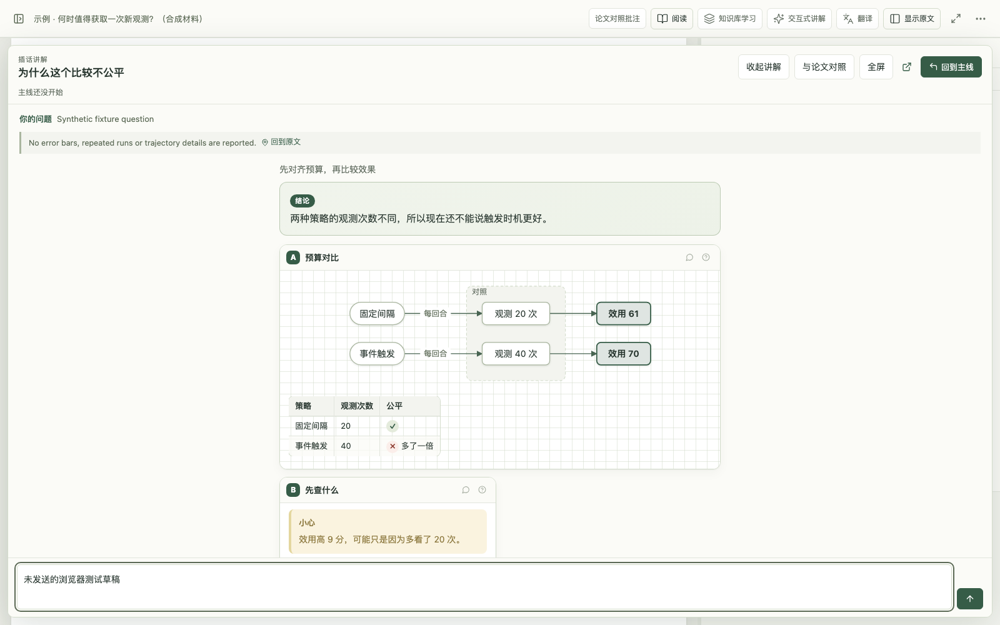

# Paper Research Coach · DeepSeek Harness 1.3.1

**工作台内核 2.0.0rc15 · macOS Apple silicon · 原生宿主检查基线 Harness 0.2.2-rc.1。** 使用 Harness 登录账户，无需 API Key 或 Codex CLI。Windows 旧分发与本次 macOS 发布分别记录。

[下载 1.3.1](https://github.com/ooooooomygosh/paper-research-coach/releases/tag/dsh-v1.3.1) · [双语研读操作](docs/BILINGUAL-READING.md) · [安装与恢复](../../docs/DEEPSEEK_HARNESS.md) · [发布说明](../../docs/releases/dsh-v1.3.1.md)



合成材料与预设回复，非实时模型输出。

## 日常功能

- 原文、中文及双语 PDF 的提问保持当前语言，划线问答留在原处，带读可跟随证据；映射不足保持待核实。
- 讲解可在应用内大阅读区展开，与 PDF 调整宽度对照，全屏或主动打开独立窗口；显示切换不重新生成内容。
- 四阶段软路线按速览、理解、研读调整任务。旧八步原始记录保留，接续原问题与阅读位置。
- 论文对照批注支持选段、章节、全文，逐段处理、停止续做、分析修订、同一用户笔记的版本检查，以及单文件离线导出。图谱节点可定位与遮住回忆。
- 原有知识库学习、交互组件、翻译队列、Zotero/目录同步、研究想法、复习和导出继续使用。
- 模型、思考深度和并发设置按需展开；当前操作与进度直接可见。

## 安装与更新

macOS 下载 [PRC-DSH-1.3.1-mac.zip](https://github.com/ooooooomygosh/paper-research-coach/releases/download/dsh-v1.3.1/PRC-DSH-1.3.1-mac.zip)，完全退出 Harness（含托盘），解压后双击 `安装.command`，再启动“论文研读”。ZIP、`dsh-release.json`、ZIP `.sha256` 和 `SHA256SUMS` 放在同一 DSH Release；仓库不提交大型安装包。源码构建保留在 [macOS 说明](macos/README.md)。

**从旧版升级会保留原有数据目录。** 1.3.1 新增的 DSH 专属更新器检查 `dsh-v*` Release，验证宿主、平台与 SHA-256，后台暂存兼容包，下一次完全退出并重启 Harness 时安装。运行中的阅读进程保持原版本。“设置 → 版本与更新”显示实际插件版本，支持手动检查。独立工作台的 wheel 更新器在 DSH 中继续关闭。

目前自动安装目标为 macOS arm64。Windows 没有兼容资产时不安装；本次没有发布 1.3.1 Windows ZIP，也没有执行 Windows 原生安装验收。`PRC-DSH-1.2.0-win-x64.zip` 与 Harness 0.2.1-rc.5 的记录属于历史版本。

论文、译文缓存、笔记和学习记录默认位于 `~/.dsh/paper-research-coach`（跟随 `DSH_HOME`）。凭证由 Harness 管理；原 PDF 保持只读。旧八步记录不覆盖，阅读计划另存。更新保留旧版、安装备份与一致性数据备份，回退应使用匹配的数据版本。

## 验证范围

本轮已做源码回归、Chrome 合成页面、离线零外部请求、旧数据副本升级，以及 macOS Harness 0.2.2-rc.1 的真实账户合成 PDF 问答与定位。自动更新的清单、校验、暂存和恢复另有隔离测试；真实未来版本的公网升级不能由本地包测试替代。[验证与限制](docs/BILINGUAL-READING.md)

本次没有真人学习收益试验和真实 Zotero 写入。章节识别为启发式；图表与公式保留原页核验图。模型生成的分析、参考答案和处理进度不作为掌握度证明。

## 源码组织

这个目录的当前基础版本为 **2.0.0rc15**，保留独立工作台与 DSH 特定模块，与仓库根目录的独立工作台分开。它是完整的适配源码贡献，不会替换独立工作台的 provider 或发布流程。

| 路径 | 内容 |
|---|---|
| `host/`、`client/`、`locale/` | Harness 账户桥接、服务生命周期、侧栏入口与本地化 |
| `upstream/src/`、`upstream/frontend/` | 工作台快照，以及账户接入、学习工作区和高亮修复 |
| `integrations/` | 两个项目的固定源码、模板、渲染器与许可 |
| `distribution/`、`scripts/build_release.py` | 可转发安装包、校验、备份、卸载与恢复 |
| `runtime/requirements.lock.txt`、`runtime/ASSET-MANIFEST.json` | Python 依赖版本和已验证翻译资源的哈希清单 |
| `macos/` | macOS 源码构建：`install-macos.sh`、`uninstall-macos.sh`、`import-legacy.sh` 与说明 |
| `SOURCE_SNAPSHOT.json` | 原项目版本、提交和公开源码文件哈希 |

原仓库与第三方仓库中的 Skill 文档作为随附源码保留；不会自动安装额外代理或服务。后续同步独立工作台需要显式移植并重新验证此快照。

## 同步独立工作台

快照与根目录的独立工作台分开演进，落后时两边的功能就不一致。同步的做法：

1. 取 `SOURCE_SNAPSHOT.json` 里 `upstream.commit`（基线）到新版本之间独立工作台改过的文件。插件没改过的文件直接换成新版本；插件也改过的做三方合并（基线、插件版本、新版本）。根目录的 README 和文档不要带进快照，它们讲的就是这个插件。
2. 运行下面的 `scripts/verify_source.py`。合并没有文本冲突不等于行为正确，要靠测试确认。
3. 运行 `python scripts/refresh_snapshot.py write --baseline <新版本的提交>`，更新 `SOURCE_SNAPSHOT.json`（版本、基线、每个文件的哈希、相对基线有改动的文件）。之后任何改动都可以用 `python scripts/refresh_snapshot.py check` 确认这份记录没有过期。
4. 更新各处写着“基于工作台 x.y.z”的说明（`README.md`、`docs/DEEPSEEK_HARNESS.md`、`功能与验收.md`、`THIRD_PARTY.md`、`distribution/README.txt`）。构建清单里的 `upstreamVersion` 已改为从 `upstream/` 里的包读取，不用再手改。

历史同步基线为独立工作台 **2.0.0rc14**；本版基础包已升为 **2.0.0rc15**，具体文件及差异由 `SOURCE_SNAPSHOT.json` 记录。

## 开发与验证

使用 Python 3.12、Node.js 24 和 npm。在本目录中运行（Windows PowerShell）：

```powershell
python -m venv .venv
npm --prefix upstream/frontend ci
npm --prefix upstream/frontend run build
& ./.venv/Scripts/python.exe -X utf8 upstream/scripts/prepare_licenses.py
& ./.venv/Scripts/python.exe -X utf8 -m pip install -e './upstream[dev]' PyPDF2==3.0.1
& ./.venv/Scripts/python.exe -X utf8 scripts/prepare_integrations.py
& ./.venv/Scripts/python.exe -X utf8 scripts/verify_source.py
```

验证脚本运行原版及新增 Python 测试、账户桥接与真实渲染器测试、TypeScript 检查、前端测试和构建，不连接账户或安装 Harness。[专用 CI](../../.github/workflows/deepseek-harness.yml) 使用 Windows 运行相同检查。原版 Skill/文档校验仍可在 `upstream/` 中运行。

已完成的 Windows 1.1.0 验证：209 项 Python 测试通过、7 项跳过；115 项前端测试、7 项 Node 测试通过。另以合成材料完成登录账户冒烟、桌面交互和真实宿主包的隔离安装/卸载检查。这些历史验证不等于本次 CI 已连接账户。macOS 侧的构建与冒烟记录写在 `macos/README.md`，只覆盖 Apple silicon 一台机器，不代表 Windows 分发包等价或已覆盖 Intel Mac；本仓库不附带个人账户收据、桌面日志或论文。

账户冒烟需要自有 Harness 运行时及登录账户，可能消耗账户额度。设置 `DSH_PRC_TEST_REFERENCE_PATH` 为解包后的 `dsh` 目录，再运行 `node scripts/smoke-harness.mjs`；设置 `PRC_LEARNING_TEST=1` 可检查学习工作区。脚本使用单独的测试书库，只发送合成教学材料。不要将该运行时或测试数据提交到仓库。

## 历史 Windows 分发构建方式

构建使用完整的 Windows x64 可搬移运行库，包含 Python、锁定依赖及 BabelDOC 0.6.4 字体/版面模型缓存。Git 源码不包含这些二进制文件。可从已验证安装包的 `package/runtime` 提供运行库；自行组装时须遵守 Python、Microsoft 运行库和各依赖的分发许可，并按清单准备资源。

```powershell
# 假定已有一份已验证运行库；此操作只准备构建目录，不安装 Harness。
python -X utf8 scripts/prepare_bundle.py --runtime 'C:/PRC-DSH/package/runtime'
& ./runtime/python/python.exe -X utf8 scripts/verify_source.py
& ./runtime/python/python.exe -X utf8 scripts/build_release.py
```

`prepare_bundle.py` 核对翻译资源哈希，复制运行库，修正本地源码优先路径并检查关键依赖；`build_release.py` 收集源码、资源、许可证和安装器，检查私有数据排除项，生成逐文件 SHA-256 清单、ZIP CRC 和 ZIP 摘要。构建前需先完成前端构建。

历史 Windows 安装器的验证基线仅为 Harness **0.2.1-rc.5**，不代表本次 macOS 1.3.1 的安装路径。宿主升级后仍需核验兼容性；DSH 不安装独立工作台 wheel。
